# 1. Yêu cầu của ban tổ chức

> **Vấn đề:** Hợp đồng và mã nguồn chưa công bố có thể chứa thông tin cần bảo vệ.
>
> **Yêu cầu:** Giới hạn quyền, thời gian lưu và khả năng xóa mã; mô tả xử lý tại máy chủ/dịch vụ ngoài.
>
> **Minh chứng:** Sơ đồ luồng dữ liệu, cấu hình quyền truy cập và demo xóa tệp.

| Yêu cầu | Giải pháp đã triển khai | Minh chứng trong báo cáo |
|---|---|---|
| Giới hạn quyền | Hai loại tài khoản (Cá nhân, Doanh nghiệp); bốn vai trò Admin, Developer, Non-tech, Expert; máy chủ kiểm tra quyền ở mọi API; Developer và Non-tech chỉ thấy mã của chính mình; nhật ký kiểm toán ghi mọi lần mở mã và mọi lần bị từ chối | Mục 3, 6 |
| Thời gian lưu | Admin đặt thời hạn lưu (1–365 ngày, mặc định 30); tác vụ nền tự xóa lượt quét quá hạn; ngày tự xóa hiện trên từng kết quả | Mục 4 |
| Khả năng xóa mã | Xóa lượt quét, dự án, tài khoản; mã bị xóa ở mọi nơi lưu; lịch sử xóa không chứa mã | Mục 4, 8 |
| Mô tả xử lý tại máy chủ / dịch vụ ngoài | Mô hình phát hiện chạy tại máy chủ; chỉ mã hàm bị gắn cờ được gửi tới LLM ngoài, mặc định bật và Admin tắt được; người dùng được thông báo ngay tại trang tải lên | Mục 2 |
| Sơ đồ luồng dữ liệu | Sơ đồ tổng hợp, sơ đồ luồng xử lý, sơ đồ luồng xóa, sơ đồ vòng tự cải thiện | Mục 1, 2.1, 4.1, 10.1 |
| Dữ liệu huấn luyện | Mã chỉ được dùng để huấn luyện lại khi người tải lên và Admin cùng đồng ý; mô hình mới phải qua kiểm định trước khi thay | Mục 10 |
| Cấu hình quyền truy cập | Bảng quyền khai báo trong mã nguồn, chính sách dữ liệu theo doanh nghiệp, biến cấu hình máy chủ | Mục 3.6 |
| Demo xóa tệp | Kịch bản tự động trên trình duyệt, nhật ký chạy, ảnh chụp từng bước | Mục 8 |

Toàn bộ các tính năng trong báo cáo đã được triển khai trên bản production https://scanguard.ptitai.org ngày 28/11/2026.

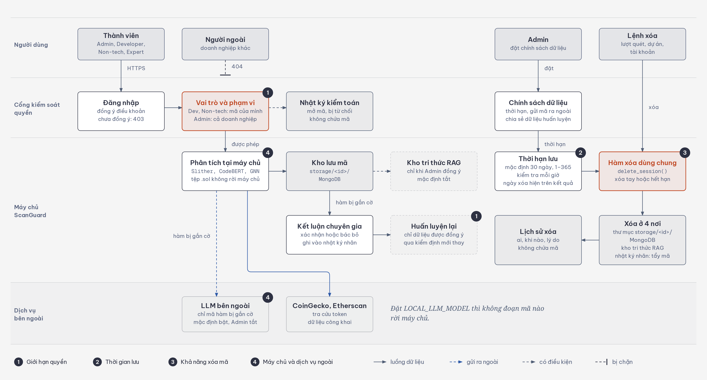{width=100%}

# 2. Xử lý tại máy chủ và dịch vụ ngoài

## 2.1. Sơ đồ luồng dữ liệu khi tải mã lên

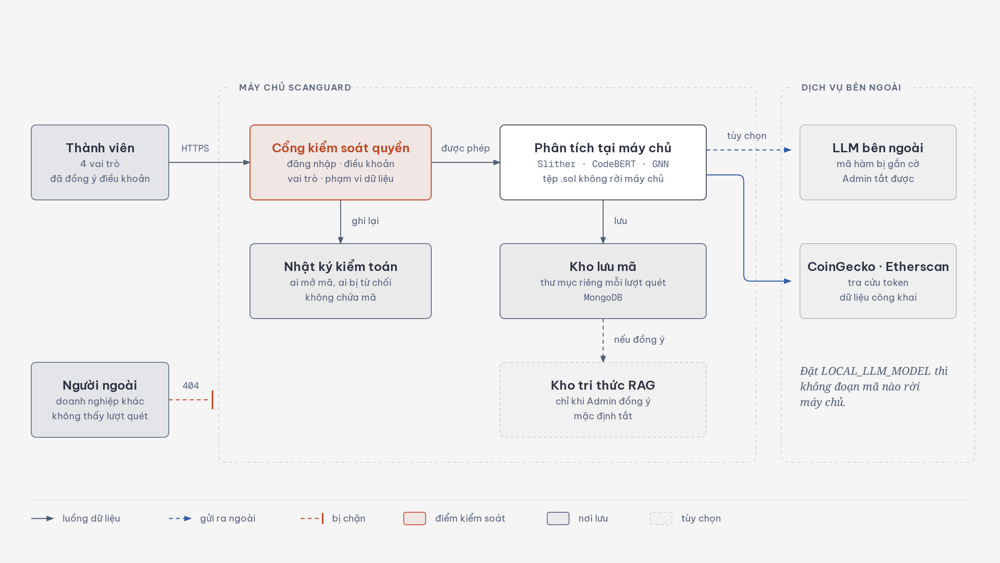{width=100%}

1. Người dùng tải tệp `.sol` qua HTTPS. Phiên đăng nhập nằm trong cookie httpOnly, trình duyệt không đọc được.
2. Backend kiểm tra đăng nhập, việc đồng ý điều khoản và quyền của vai trò, rồi lưu tệp vào một thư mục riêng cho lượt quét đó.
3. Ba mô hình phát hiện lỗ hổng (Slither, CodeBERT, GNN) chạy hoàn toàn trên máy chủ ScanGuard.
4. Kết quả, mã từng hàm và bản sửa được lưu trong MongoDB của máy chủ.
5. Mã của từng hàm bị gắn cờ (không phải toàn bộ tệp) được gửi tới dịch vụ LLM để viết giải thích và gợi ý sửa lỗi. Tùy chọn này mặc định bật; Admin tắt được trong trang Chính sách dữ liệu.

## 2.2. Dữ liệu nào đi đâu

| Dữ liệu | Đi tới | Điều kiện |
|---|---|---|
| Tệp `.sol` đầy đủ | Chỉ máy chủ ScanGuard | Luôn luôn |
| Mã của từng hàm bị gắn cờ | Cổng LLM bên ngoài `token.astralx.com.vn` | Mặc định bật. Admin tắt bằng tùy chọn "Gửi mã các hàm bị gắn cờ tới dịch vụ AI bên ngoài". Khi tắt, máy chủ không gửi gì ra ngoài: phần giải thích bị bỏ qua và trợ lý sửa lỗi bị chặn ở máy chủ |
| Tên token, địa chỉ hợp đồng | CoinGecko, Etherscan | Chỉ khi tra cứu token; đây là dữ liệu công khai |
| Email, họ tên người dùng | Không đi ra ngoài | — |
| Mã hàm và kết luận rà soát | Kho tri thức, dữ liệu huấn luyện | Chỉ khi Admin đồng ý cho doanh nghiệp dùng mã làm dữ liệu huấn luyện |

Máy chủ cũng hỗ trợ chạy LLM ngay tại máy chủ (biến `LOCAL_LLM_MODEL`); khi đó không có mã nào rời khỏi máy chủ trong mọi trường hợp.

Bước biên dịch và kiểm tra bản sửa chạy trong một tiến trình cô lập, giới hạn thời gian và bộ nhớ, không mang theo khóa bí mật của máy chủ.

## 2.3. Người dùng được thông báo ngay tại trang tải lên

Trang tải lên hiện thời hạn lưu của doanh nghiệp và cho biết mã hàm có được gửi ra dịch vụ AI bên ngoài hay không, theo chính sách hiện tại của doanh nghiệp đó.

# 3. Giới hạn quyền

## 3.1. Hai loại tài khoản

Khi đăng ký, người dùng chọn một trong hai loại:

- **Cá nhân (khách):** không gian làm việc riêng cho một người, toàn quyền với mã của chính mình, không thêm được thành viên.
- **Doanh nghiệp:** phải nhập tên doanh nghiệp; người đăng ký trở thành Admin, thêm thành viên và phân vai trò.

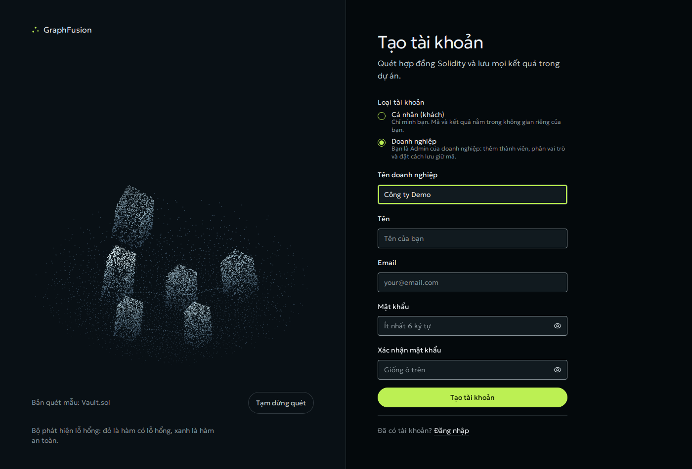{width=85%}

## 3.2. Bốn vai trò trong doanh nghiệp

| Vai trò | Dành cho | Đặc điểm |
|---|---|---|
| Admin | Quản trị kinh doanh của doanh nghiệp | Quản lý thành viên, chính sách dữ liệu, nhật ký; không tự sửa mã, không duyệt cảnh báo |
| Developer | Lập trình viên | Tải mã, xem mã, dùng công cụ sửa lỗi; chỉ thấy mã của mình |
| Non-tech | Quản lý, nhà đầu tư, pháp chế | Quyền như Developer; giao diện và lời giải thích không dùng thuật ngữ chuyên môn |
| Expert | Chuyên gia rà soát nội bộ | Xác nhận hoặc bác bỏ cảnh báo, duyệt bản sửa |

Đội vận hành ScanGuard không phải một vai trò của khách hàng. Tài khoản chuyên gia của ScanGuard (Expert không thuộc doanh nghiệp nào) chỉ mở được một lượt quét khi doanh nghiệp bật quyền cho chuyên gia ScanGuard và chủ lượt quét đã bấm "Gửi chuyên gia rà soát".

## 3.3. Bảng quyền

| Quyền | Admin | Developer | Non-tech | Expert |
|---|---|---|---|---|
| Tải mã lên, tạo dự án, tra cứu token | ✓ | ✓ | ✓ | ✓ |
| Xem mã nguồn, IDE, mã từng hàm, tải SARIF | ✓ | ✓ (của mình) | ✓ (của mình) | ✓ |
| Trợ lý sửa lỗi, repair agent, biên dịch bản sửa | ✗ ¹ | ✓ | ✓ | ✓ |
| Gửi lượt quét cho chuyên gia rà soát | ✓ | ✓ | ✓ | ✗ |
| Xóa lượt quét | Mọi lượt | Của mình | Của mình | ✗ |
| Xóa dự án | Mọi dự án | Dự án mình tạo | Dự án mình tạo | ✗ |
| Xác nhận hoặc bác bỏ cảnh báo, duyệt bản sửa | ✗ | ✗ | ✗ | ✓ |
| Quản lý thành viên, chính sách dữ liệu, nhật ký kiểm toán, lịch sử xóa | ✓ | ✗ | ✗ | ✗ |

¹ Tài khoản Cá nhân (khách) có toàn quyền với mã của mình, kể cả các công cụ sửa lỗi.

## 3.4. Phạm vi dữ liệu

| Vai trò | Thấy dự án và lượt quét |
|---|---|
| Developer, Non-tech | Chỉ của chính mình |
| Admin | Toàn bộ doanh nghiệp |
| Expert nội bộ | Toàn bộ doanh nghiệp, để rà soát |
| Chuyên gia ScanGuard | Chỉ lượt quét được gửi rà soát, ở doanh nghiệp cho phép |
| Người ngoài doanh nghiệp | Không thấy gì; truy cập trả về "không tìm thấy" |

## 3.5. Cơ chế thực thi

- **Kiểm tra ở máy chủ, không chỉ ở giao diện.** Mọi API đọc hoặc sửa lượt quét đều đi qua một hàm kiểm tra theo doanh nghiệp, vai trò và chủ sở hữu. Giao diện chỉ ẩn những nút mà máy chủ sẽ từ chối.
- **Không lộ sự tồn tại.** Lượt quét ngoài phạm vi trả về 404 như không tồn tại; lần truy cập đó vẫn được ghi vào nhật ký của doanh nghiệp sở hữu.
- **Đổi quyền có hiệu lực ngay.** Khi Admin đổi vai trò hoặc khóa một tài khoản, mọi phiên đăng nhập cũ của người đó bị vô hiệu ngay.
- **Doanh nghiệp không mất quyền quản trị.** Hệ thống không cho hạ quyền, khóa hay xóa Admin hoạt động cuối cùng.
- **Tách vai trò quản trị và rà soát.** Admin không xác nhận cảnh báo và không duyệt bản sửa; chuyên gia không được tự rà soát lượt quét do chính mình tải lên.

## 3.6. Cấu hình quyền truy cập

**Bảng quyền trong mã nguồn** (`src/services/access.py`), một chỗ duy nhất máy chủ tra cứu:

| Quyền | Vai trò được phép |
|---|---|
| `upload` | admin, developer, non_tech, expert |
| `view_source` | admin, developer, non_tech, expert |
| `fix_tools` | developer, non_tech, expert (và admin của tài khoản cá nhân) |
| `request_review` | admin, developer, non_tech |
| `delete_own_session` | admin, developer, non_tech |
| `delete_any_session` | admin |
| `delete_project` | admin (và người tạo dự án có quyền xóa lượt quét của mình) |
| `review` | expert |
| `manage_organization` | admin |

Developer và Non-tech thuộc nhóm `OWN_ONLY`: phạm vi dữ liệu bị giới hạn thêm theo người tạo.

**Chính sách dữ liệu theo doanh nghiệp** (Admin chỉnh trong dashboard; mỗi lần đổi được ghi nhật ký):

| Thiết lập | Mặc định | Ý nghĩa |
|---|---|---|
| `retention_days` | 30 | Số ngày lưu lượt quét và mã, 1–365 |
| `external_llm` | Bật | Gửi mã hàm bị gắn cờ tới LLM bên ngoài |
| `training_data` | Tắt | Cho dùng mã và kết luận rà soát làm dữ liệu huấn luyện |
| `platform_experts` | Tắt | Cho chuyên gia ScanGuard mở lượt quét được gửi rà soát |

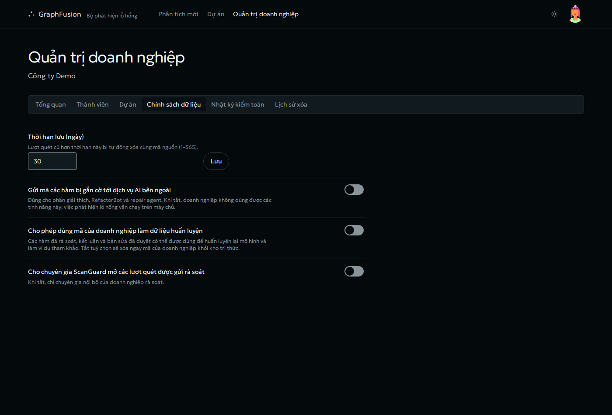{width=90%}

**Biến cấu hình máy chủ** (`.env`):

| Biến | Mặc định | Ý nghĩa |
|---|---|---|
| `RETENTION_DAYS` | 30 | Thời hạn lưu mặc định cho doanh nghiệp mới |
| `RETENTION_ENABLED` | true | Bật tác vụ tự xóa lượt quét quá hạn |
| `RETENTION_INTERVAL_SECONDS` | 3600 | Chu kỳ chạy tác vụ tự xóa |
| `LOCAL_LLM_MODEL` | (trống) | Khi đặt, LLM chạy ngay tại máy chủ |
| `SANDBOX_TIMEOUT`, `SANDBOX_MEMORY_MB` | 120, 2048 | Giới hạn tiến trình kiểm tra bản sửa |
| `ACCESS_TOKEN_EXPIRE_MINUTES` | 30 | Thời hạn phiên đăng nhập |

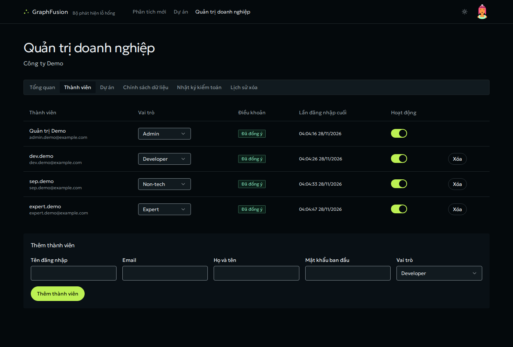{width=90%}

# 4. Thời gian lưu và xóa mã

## 4.1. Sơ đồ luồng xóa

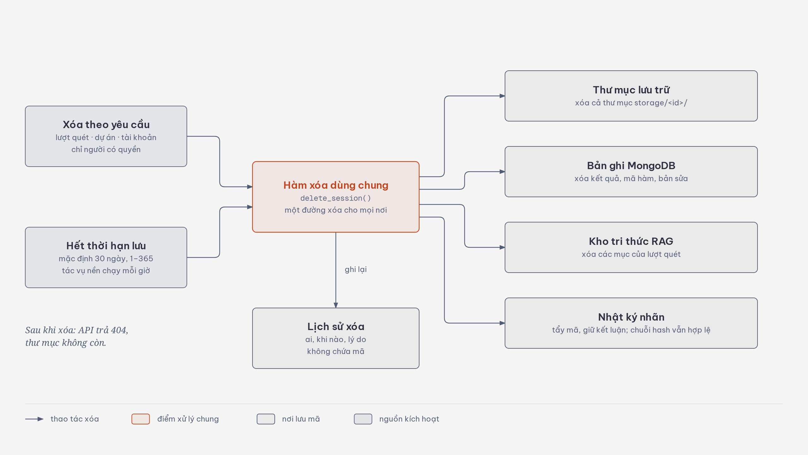{width=100%}

Xóa thủ công và xóa tự động dùng chung một hàm, nên kết quả giống nhau:

| Nơi lưu | Nội dung | Khi xóa lượt quét |
|---|---|---|
| Thư mục lưu trữ của lượt quét | Tệp `.sol`, đồ thị FCG, tệp ánh xạ | Xóa cả thư mục |
| MongoDB `analysis_sessions` | Kết quả, mã từng hàm, bản sửa, kết luận rà soát | Xóa bản ghi |
| Kho tri thức `knowledge` | Mã hàm và bản sửa đã duyệt (chỉ khi đồng ý chia sẻ) | Xóa các mục của lượt quét |
| Nhật ký nhãn `label_events` | Kết luận chuyên gia | Tẩy mã, ghi chú, đường dẫn; giữ kết luận; chuỗi hash vẫn hợp lệ |
| Danh sách tệp của dự án | Đường dẫn tệp | Gỡ tham chiếu |
| Lịch sử xóa `deletion_log` | Ai xóa, xóa gì, lý do, số mục đã xóa | Ghi thêm một dòng, không chứa mã |

Tệp bị xóa trước, bản ghi bị xóa sau cùng: nếu có lỗi giữa chừng, bản ghi vẫn còn để xóa lại, không để lại mã "mồ côi". Bộ đệm embedding chỉ lưu vector theo mã băm sha256 của mã, không lưu mã.

## 4.2. Nhật ký nhãn: xóa được mã mà vẫn chống sửa

Nhật ký nhãn là chuỗi sự kiện nối nhau bằng hash để chứng minh dữ liệu huấn luyện không bị sửa. Phiên bản 2 đưa các trường có thể chứa mã hoặc tên người (`function_code`, `file_path`, `graph_path`, `note`, `reviewer`) vào hash dưới dạng sha256 thay vì giá trị gốc. Nhờ vậy:

- Xóa mã khỏi một sự kiện không phá chuỗi hash.
- Trường còn giữ vẫn phải khớp sha256 của nó, nên mọi chỉnh sửa vẫn bị phát hiện.
- Kết luận của người dùng không đồng ý chia sẻ dữ liệu không lưu mã hàm ngay từ đầu.

Có công cụ chuyển dữ liệu cũ sang phiên bản 2 (`scripts/migrate_label_log_v2.py`); công cụ từ chối chuyển nếu chuỗi hiện tại không còn nguyên vẹn.

## 4.3. Thời hạn lưu tự động

- Mỗi doanh nghiệp có thời hạn lưu riêng; tác vụ nền chạy mỗi giờ và xóa mọi lượt quét quá hạn, ghi lý do "Hết thời hạn lưu" vào lịch sử xóa.
- Mỗi kết quả quét hiện "Tự động xóa vào ngày …".
- Dashboard Admin hiện số lượt quét sẽ bị xóa trong 7 ngày tới.

## 4.4. Xóa theo yêu cầu

- **Lượt quét:** nút "Xóa lượt quét" trên trang kết quả.
- **Dự án:** xóa dự án cùng mọi lượt quét trong đó.
- **Tài khoản:** người dùng tự xóa trong mục Quyền riêng tư. Với tài khoản Cá nhân, toàn bộ dự án, lượt quét và mã bị xóa theo; với doanh nghiệp, lượt quét thuộc doanh nghiệp nên được giữ, tên người dùng trên các kết luận rà soát được thay bằng mã ẩn danh.
- **Rút lại đồng ý chia sẻ dữ liệu:** Admin tắt tùy chọn; mã của doanh nghiệp bị gỡ khỏi kho tri thức ngay và các lượt quét cũ được đánh dấu không đồng ý. Kết luận đã ghi trước đó trong nhật ký nhãn vẫn giữ cờ đồng ý cũ (xem mục 11).

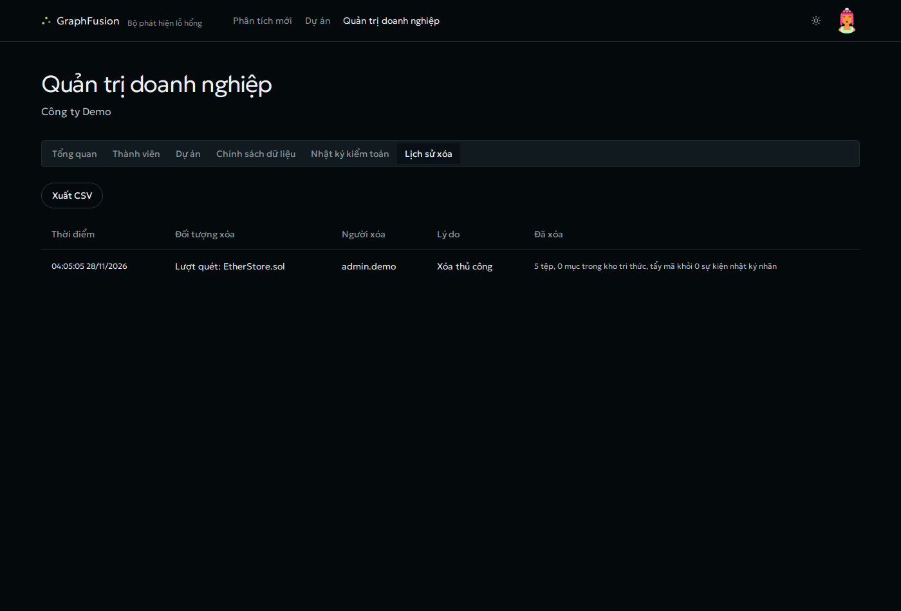{width=90%}

# 5. Đồng ý điều khoản và dữ liệu cá nhân

Người dùng mới phải đọc và đồng ý ba văn bản bắt buộc trước khi dùng sản phẩm: **Điều khoản sử dụng và giấy phép phần mềm**, **Chính sách xử lý dữ liệu cá nhân và mã nguồn**, **Cam kết quyền tải mã lên**. Văn bản thứ tư, **Cho dùng mã làm dữ liệu huấn luyện**, không bắt buộc, mặc định tắt và do Admin quyết định cho doanh nghiệp.

- Không ô nào được chọn sẵn, không có nút "Đồng ý tất cả".
- Văn bản có bản tiếng Việt và tiếng Anh, hiển thị theo ngôn ngữ người dùng chọn.
- Máy chủ từ chối mọi API, trừ xem văn bản, xác nhận, đổi mật khẩu, đăng xuất và xóa tài khoản, cho tới khi người dùng đồng ý.
- Mỗi lần đồng ý được lưu (văn bản, phiên bản, thời điểm). Khi văn bản đổi phiên bản, người dùng được hỏi lại ở lần đăng nhập sau.
- Người dùng đọc lại các văn bản và xóa tài khoản trong mục Quyền riêng tư.

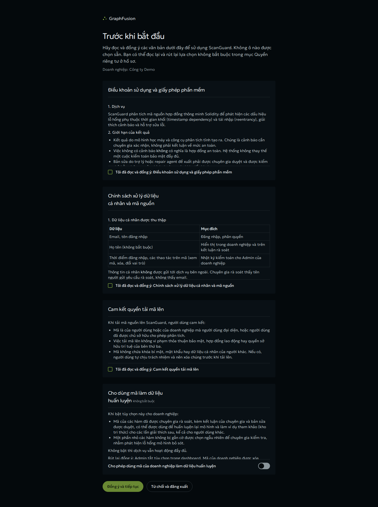{width=70%}

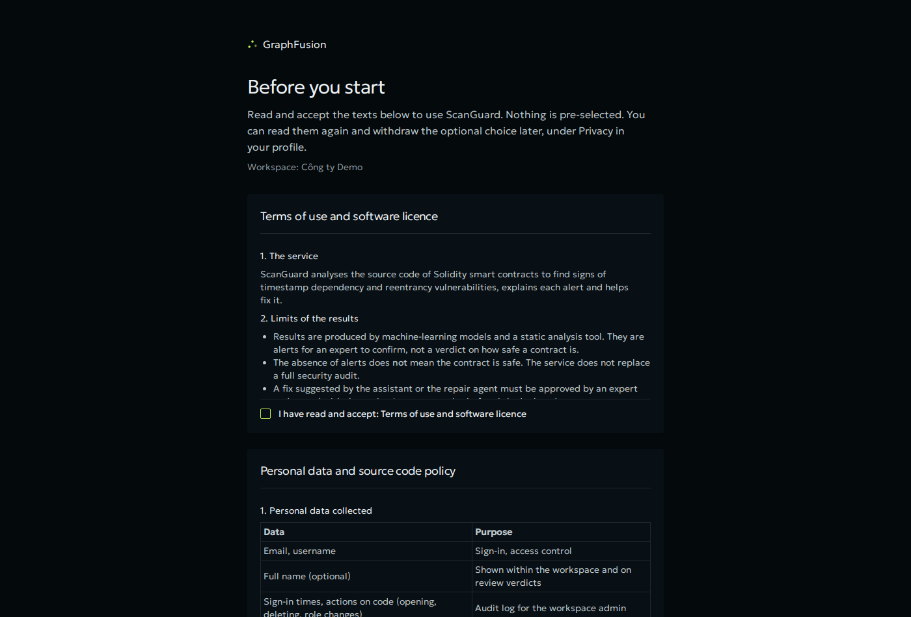{width=85%}

# 6. Dashboard quản trị doanh nghiệp

Dashboard dành cho Admin, gồm sáu trang: Tổng quan, Thành viên, Dự án, Chính sách dữ liệu, Nhật ký kiểm toán, Lịch sử xóa. Dashboard chỉ hiện thông tin mô tả, không hiện mã nguồn.

- **Tổng quan:** số lượt quét, cảnh báo chờ rà soát, bản sửa đã duyệt, dung lượng mã đang lưu; biểu đồ lượt quét theo ngày trong 30 ngày, cảnh báo theo loại vấn đề, kết luận của chuyên gia, thành viên theo vai trò.
- **Dự án:** biểu đồ lượt quét theo dự án, xóa dự án.
- **Nhật ký kiểm toán:** biểu đồ hoạt động theo ngày, lọc theo người, thao tác, khoảng thời gian; xuất CSV. Mọi lần mở mã nguồn, xuất SARIF, bị từ chối truy cập, xóa, đổi vai trò, đổi chính sách và xác nhận điều khoản đều được ghi.
- Giao diện có chế độ sáng và tối.

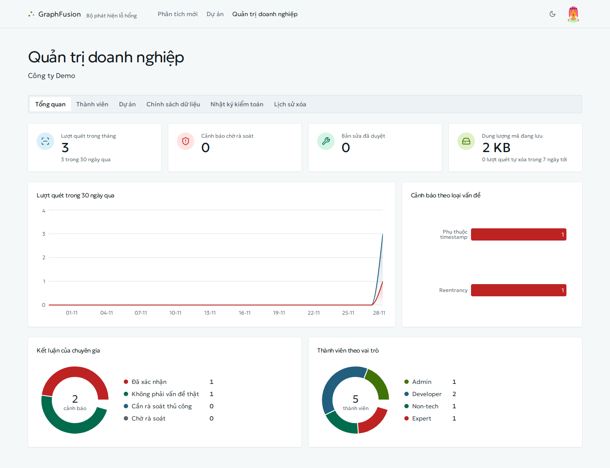{width=100%}

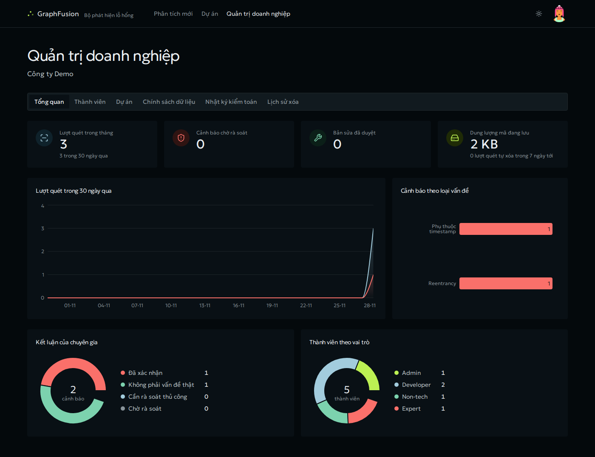{width=100%}

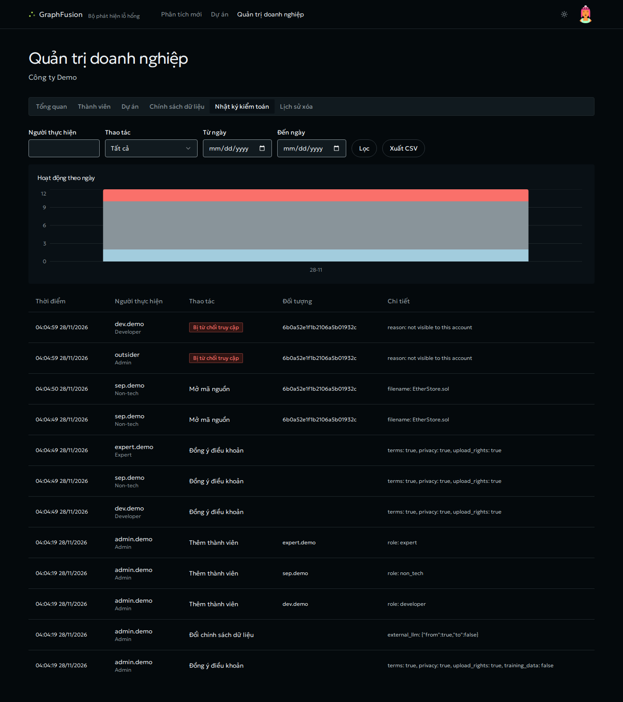{width=100%}

# 7. Hỗ trợ người dùng không chuyên kỹ thuật

Tài khoản Non-tech có quyền như Developer nhưng giao diện thay thuật ngữ bằng lời lẽ phổ thông, ví dụ:

| Thuật ngữ | Cách hiển thị cho Non-tech |
|---|---|
| Reentrancy | Nguy cơ bị rút tiền lặp lại |
| Timestamp dependency | Phụ thuộc vào đồng hồ của mạng |
| Model confidence | Mức chắc chắn của hệ thống |
| Download SARIF (IDE/CI) | Tải báo cáo cho lập trình viên |
| Function | Phần của mã |

Lời giải thích của AI cho lượt quét do Non-tech tải lên và câu trả lời của trợ lý sửa lỗi cũng được yêu cầu viết không dùng thuật ngữ chuyên môn.

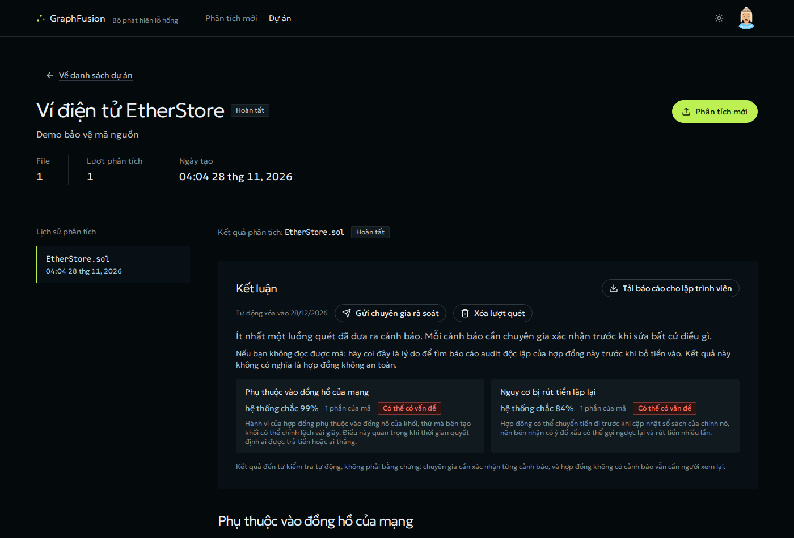{width=100%}

# 8. Demo xóa tệp

Kịch bản chạy tự động bằng trình duyệt trên một bản chạy riêng của hệ thống (`demo/protect_demo.py`); nhật ký đầy đủ trong `docs/bao_ve_ma_nguon/demo_transcript.txt`.

1. Admin đăng ký tài khoản Doanh nghiệp, đồng ý điều khoản, tắt gửi mã ra LLM ngoài, thêm Developer, Non-tech, Expert.
2. Trước khi đồng ý điều khoản, mọi API trả 403 "consent_required".
3. Non-tech tạo dự án và quét `EtherStore.sol`; tệp được lưu ở một thư mục riêng, kết quả hiện ngày tự xóa.
4. Developer (không phải người tải lên) mở mã nguồn của lượt quét đó: **404**. Người thuộc doanh nghiệp khác: **404**. Cả hai lần đều được ghi vào nhật ký kiểm toán. Admin doanh nghiệp dùng trợ lý sửa lỗi: **403**.
5. Admin bấm "Xóa lượt quét" và xác nhận.
6. Sau khi xóa: API mở mã trả **404**; thư mục lưu trữ của lượt quét không còn; lịch sử xóa ghi 5 tệp đã xóa.

Trích nhật ký chạy:

```text
before consent GET /sessions -> 403 {'detail': {'code': 'consent_required', 'missing': ['terms', 'privacy', 'upload_rights']}}
stored at ./storage/20261128_040449_292pp6qj/EtherStore.sol expires_at 2026-12-28T04:04:49.183000Z
non_tech GET source -> 200
business admin fix assistant -> 403
other workspace GET source -> 404
another member (developer) GET source -> 404
storage before delete: ['20261128_040449_292pp6qj', 'embedding_cache.sqlite', 'embedding_cache.sqlite-shm', 'embedding_cache.sqlite-wal']
after delete GET source -> 404 {'detail': 'Analysis session not found'}
storage after delete: ['embedding_cache.sqlite', 'embedding_cache.sqlite-shm', 'embedding_cache.sqlite-wal'] dir still there: False
```

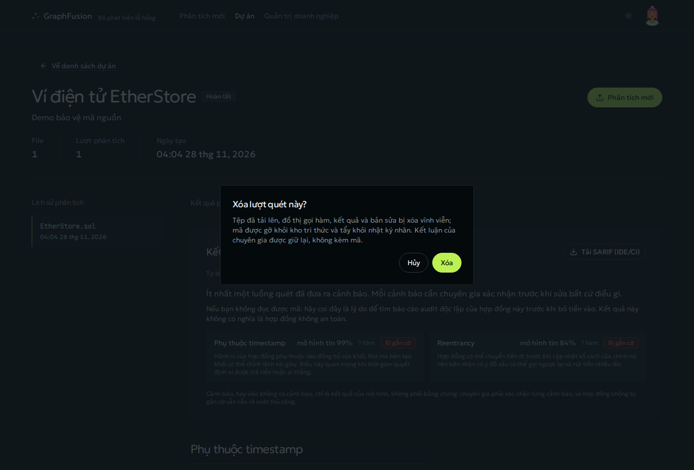{width=100%}

{width=90%}

# 9. Kiểm thử và triển khai

## 9.1. Kiểm thử tự động

81 bài kiểm thử của backend đều qua (chạy lại ngày 28/11/2026), trong đó bộ `tests/test_code_protection.py` chạy trên một MongoDB riêng và kiểm tra:

- Chưa đồng ý điều khoản thì API trả 403; từ chối mục bắt buộc thì không lưu được; văn bản trả đúng ngôn ngữ.
- Tài khoản Doanh nghiệp phải có tên doanh nghiệp; tài khoản Cá nhân không thêm được thành viên.
- Non-tech có quyền như Developer; Developer và Non-tech chỉ thấy mã của mình; Admin thấy toàn bộ; doanh nghiệp khác không thấy gì; các lần bị từ chối có trong nhật ký kiểm toán.
- Người tạo dự án xóa được dự án của mình; thành viên khác không xóa được.
- Xóa lượt quét gỡ thư mục lưu trữ, bản ghi và mục kho tri thức; mã trong nhật ký nhãn bị tẩy và chuỗi hash vẫn hợp lệ.
- Tự xóa theo thời hạn chỉ xóa lượt quét quá hạn.
- Tắt LLM ngoài thì trợ lý sửa lỗi bị chặn; rút đồng ý chia sẻ dữ liệu thì lượt quét cũ bị đánh dấu không đồng ý.
- Doanh nghiệp luôn còn Admin; đổi vai trò làm phiên đăng nhập cũ hết hiệu lực.
- Xóa tài khoản Cá nhân xóa cả không gian làm việc và mã.
- Nhật ký nhãn phiên bản 1 chuyển được sang phiên bản 2; chuỗi bị sửa thì từ chối chuyển; sửa mã hoặc kết luận sau khi ghi đều bị phát hiện.
- Tài khoản cũ được tự chuyển thành không gian làm việc Cá nhân; chạy lại không đổi gì.

## 9.2. Triển khai trên production

- Triển khai trên https://scanguard.ptitai.org ngày 28/11/2026.
- Trước mỗi lần triển khai, cơ sở dữ liệu được sao lưu đầy đủ.
- Khi khởi động, các tài khoản có từ trước được tự chuyển thành không gian làm việc Cá nhân với vai trò Admin, các lượt quét cũ được gắn đúng không gian làm việc.
- Doanh nghiệp mẫu "ScanGuard Demo" được tạo với đủ bốn vai trò để trình diễn.

# 10. Dữ liệu huấn luyện và vòng tự cải thiện

Mô hình được huấn luyện lại từ kết luận của chuyên gia. Mã của người dùng chỉ đi vào vòng này khi có đủ hai lớp đồng ý: người tải lên đồng ý và Admin bật "Cho phép dùng mã làm dữ liệu huấn luyện". Cả hai mặc định tắt.

## 10.1. Sơ đồ vòng tự cải thiện

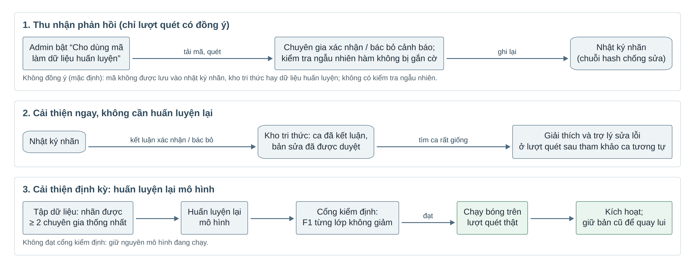{width=100%}

## 10.2. Các bước và chốt bảo vệ mã

| Bước | Việc hệ thống làm | Chốt bảo vệ mã |
|---|---|---|
| 1. Đồng ý khi tải lên | Lượt quét được đánh dấu `training_consent` | Chỉ có hiệu lực khi người tải lên đồng ý và chính sách doanh nghiệp bật `training_data` |
| 2. Chuyên gia kết luận | Xác nhận hoặc bác bỏ từng hàm bị gắn cờ; thêm 5% hàm không bị gắn cờ được chọn ngẫu nhiên để tìm lỗ hổng bị bỏ sót (`RANDOM_AUDIT_RATE`) | Chọn ngẫu nhiên chỉ áp dụng cho lượt quét có đồng ý; chuyên gia không được rà soát mã do chính mình tải lên |
| 3. Nhật ký nhãn | Mỗi kết luận là một sự kiện, nối nhau bằng chuỗi hash | Chỉ lưu mã hàm khi có đồng ý; xóa lượt quét thì mã bị tẩy, chuỗi hash vẫn hợp lệ |
| 4. Kho tri thức RAG | Kết luận đã duyệt làm ví dụ tham khảo khi viết giải thích | Chỉ nhận mục có đồng ý; Admin rút đồng ý thì gỡ ngay; xóa lượt quét thì gỡ theo |
| 5. Tạo bộ dữ liệu | `scripts/build_feedback_dataset.py` | Chỉ lấy kết luận có cờ đồng ý và có ít nhất 2 chuyên gia thống nhất; lượt quét đã xóa tự bị loại vì đường dẫn đồ thị đã bị tẩy; giữ 30% làm tập kiểm định, không dùng để huấn luyện; bộ dữ liệu chỉ lưu đường dẫn và mã băm, không chép mã |
| 6. Huấn luyện lại | `scripts/retrain.py` tạo mô hình ứng viên | Không tự thay mô hình đang dùng |
| 7. Kiểm định | `scripts/gate.py`: F1 của từng lớp không giảm quá ngưỡng trên tập kiểm thử chuẩn và tập kiểm định; kiểm định McNemar không cho thấy ứng viên kém hơn | Không đạt thì giữ mô hình cũ |
| 8. Chạy song song (tùy chọn) | Mô hình ứng viên chấm cùng các lượt quét thật; `scripts/shadow_report.py` so sánh với mô hình hiện tại và kết luận chuyên gia | Chạy tại máy chủ, không gửi gì ra ngoài |
| 9. Thay mô hình | `models/registry.json` ghi phiên bản đang dùng | Bản cũ được giữ để quay lại |

# 11. Giới hạn hiện tại và hướng tiếp theo

| Giới hạn | Hướng xử lý |
|---|---|
| Gửi mã hàm bị gắn cờ tới LLM ngoài đang mặc định bật | Chuyển sang mặc định tắt cho doanh nghiệp mới, hoặc đặt `LOCAL_LLM_MODEL` để chạy LLM tại máy chủ |
| Bản sao lưu cơ sở dữ liệu không tự xóa theo thời hạn lưu | Sao lưu xoay vòng, giữ tối đa bằng thời hạn lưu |
| Tệp và cơ sở dữ liệu chưa mã hóa khi lưu | Bật mã hóa ổ đĩa trên máy chủ |
| MongoDB chưa đặt mật khẩu, chỉ truy cập được trong mạng nội bộ Docker | Bật xác thực MongoDB |
| Tác vụ tự xóa chạy mỗi giờ, có thể trễ tối đa một giờ so với hạn | Giảm `RETENTION_INTERVAL_SECONDS` khi cần chặt hơn |
| Rút đồng ý chưa áp vào các kết luận đã ghi trong nhật ký nhãn: bước tạo bộ dữ liệu vẫn đọc cờ đồng ý tại thời điểm ghi | Khi tạo bộ dữ liệu, đối chiếu thêm cờ đồng ý hiện tại của lượt quét và chính sách doanh nghiệp |
| Mô hình đã huấn luyện không quên được dữ liệu của lượt quét bị xóa sau đó | Chỉ đưa dữ liệu đã được đồng ý vào huấn luyện; giữ các phiên bản mô hình để huấn luyện lại khi cần |

# Phụ lục: Mã nguồn liên quan

| Tệp | Nội dung |
|---|---|
| `src/services/access.py` | Vai trò, bảng quyền, phạm vi dữ liệu |
| `src/services/organizations.py` | Doanh nghiệp, chính sách dữ liệu, chuyển tài khoản cũ |
| `src/services/data_lifecycle.py` | Hàm xóa dùng chung, thời hạn lưu, tác vụ tự xóa |
| `src/services/label_log.py` | Nhật ký nhãn phiên bản 2, tẩy dữ liệu |
| `src/services/audit.py` | Nhật ký kiểm toán, xuất CSV |
| `src/services/legal.py`, `src/legal/` | Văn bản điều khoản tiếng Việt và tiếng Anh |
| `src/api/v1/organization_router.py` | API dashboard Admin |
| `src/api/v1/analyze_router.py`, `project_router.py`, `authentication_router.py` | Kiểm tra quyền, xóa, đồng ý điều khoản, xóa tài khoản |
| `web_react/src/pages/Admin.tsx`, `Consent.tsx` | Dashboard Admin, màn hình xác nhận |
| `web_react/src/components/SessionActions.tsx`, `PrivacyDialog.tsx` | Xóa lượt quét, gửi rà soát, quyền riêng tư |
| `scripts/migrate_label_log_v2.py` | Chuyển nhật ký nhãn sang phiên bản 2 |
| `tests/test_code_protection.py` | Kiểm thử tích hợp |
| `scripts/build_feedback_dataset.py`, `retrain.py`, `gate.py`, `shadow_report.py` | Vòng tự cải thiện: bộ dữ liệu, huấn luyện lại, kiểm định, chạy song song |
| `src/services/model_registry.py` | Phiên bản mô hình đang dùng, quay lại bản cũ |

## 7. Giao diện sáng

Các màn hình trên chụp lại ở giao diện sáng (người dùng chọn trong Cài đặt), cùng bản chạy cục bộ, kịch bản `demo/protect_demo_light.py`.

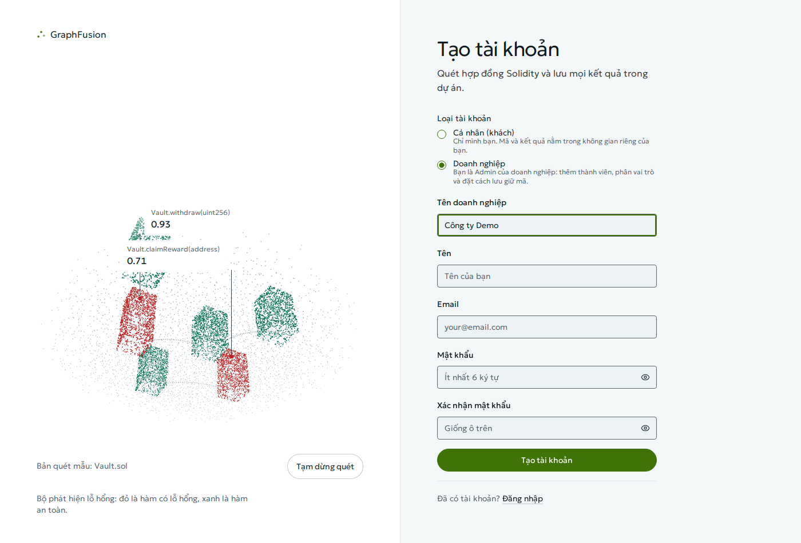

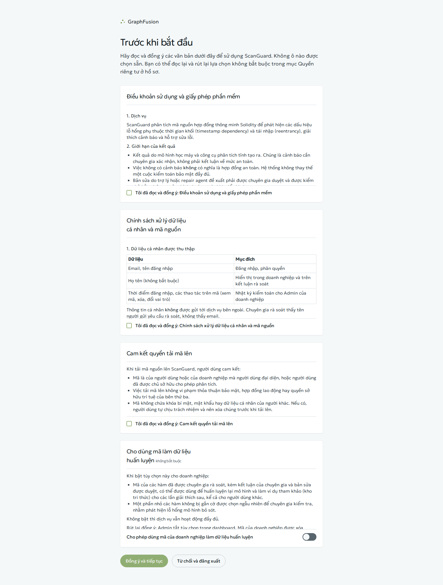

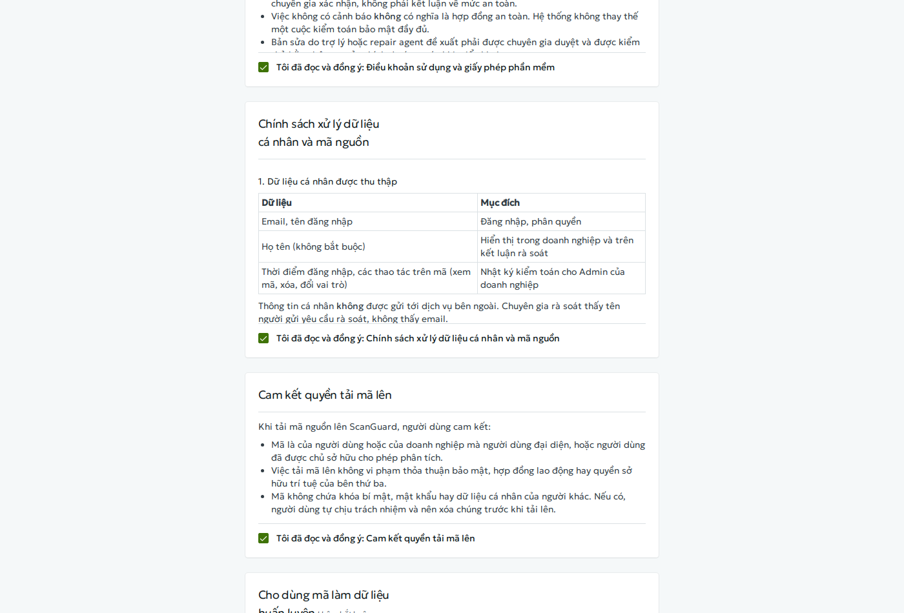

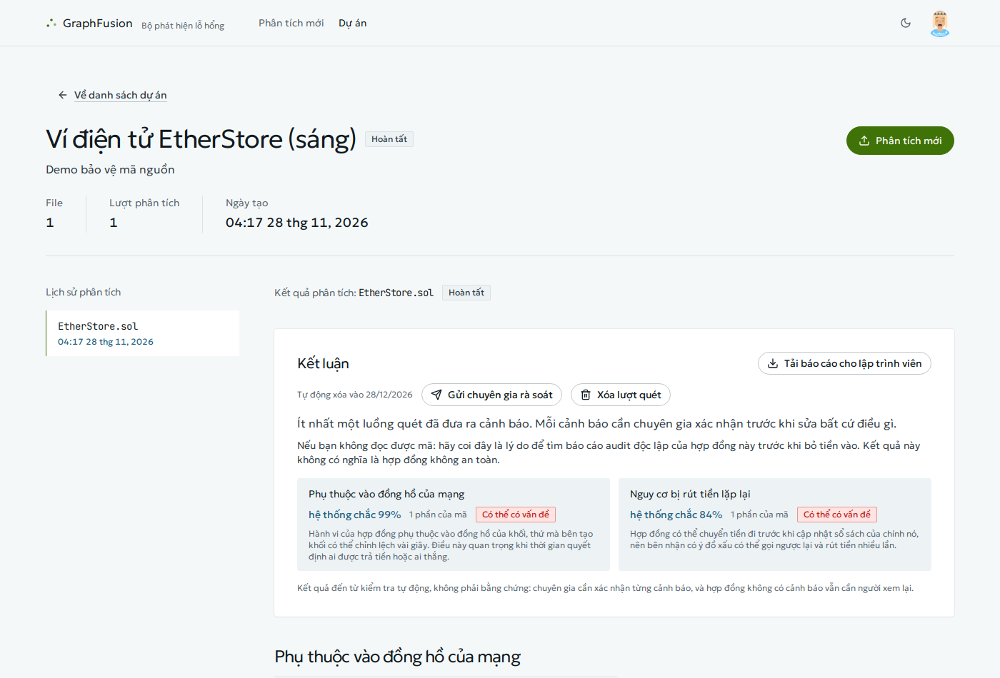

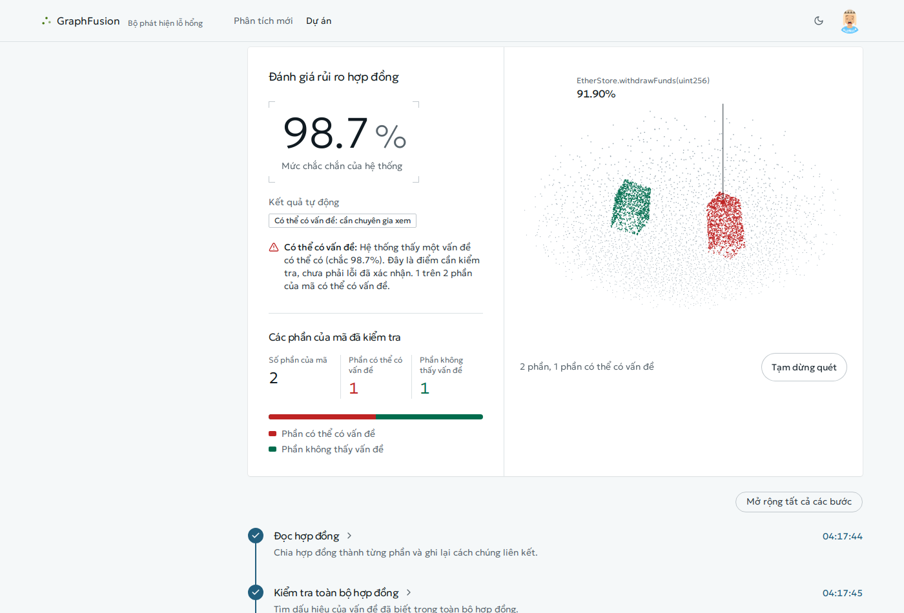

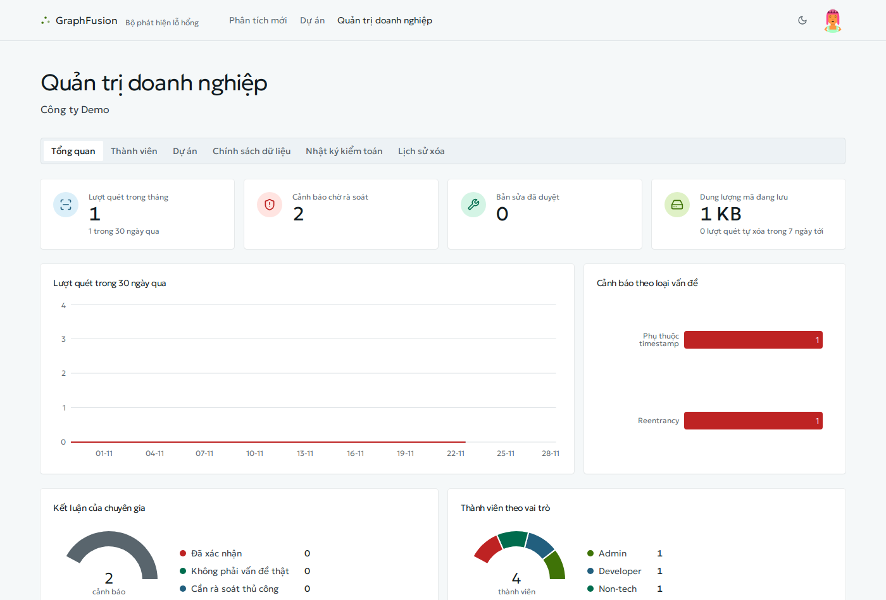

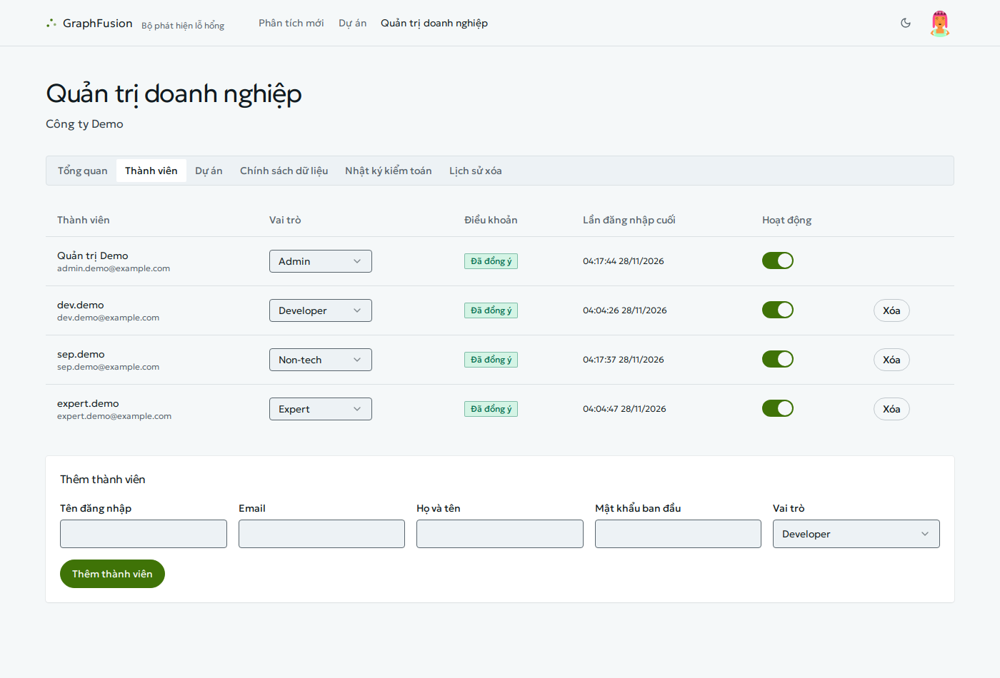

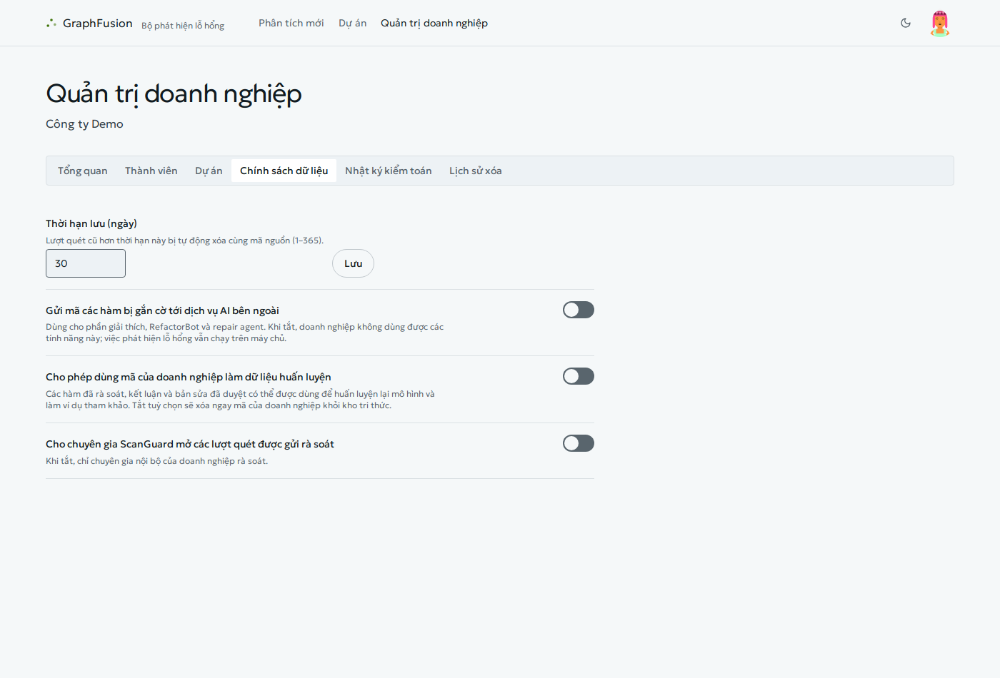

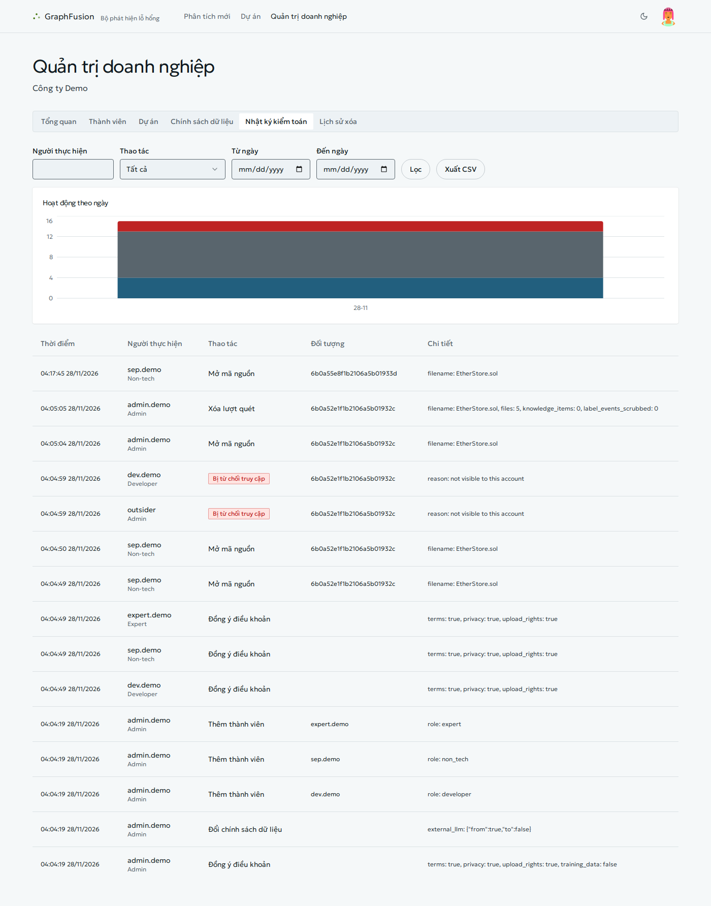

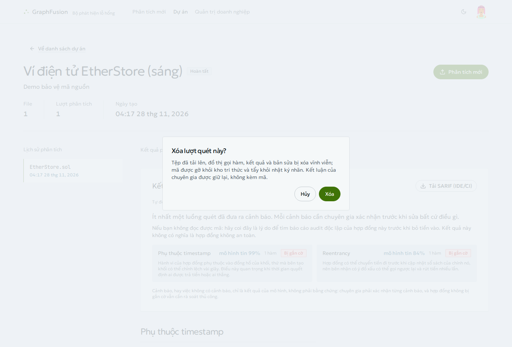

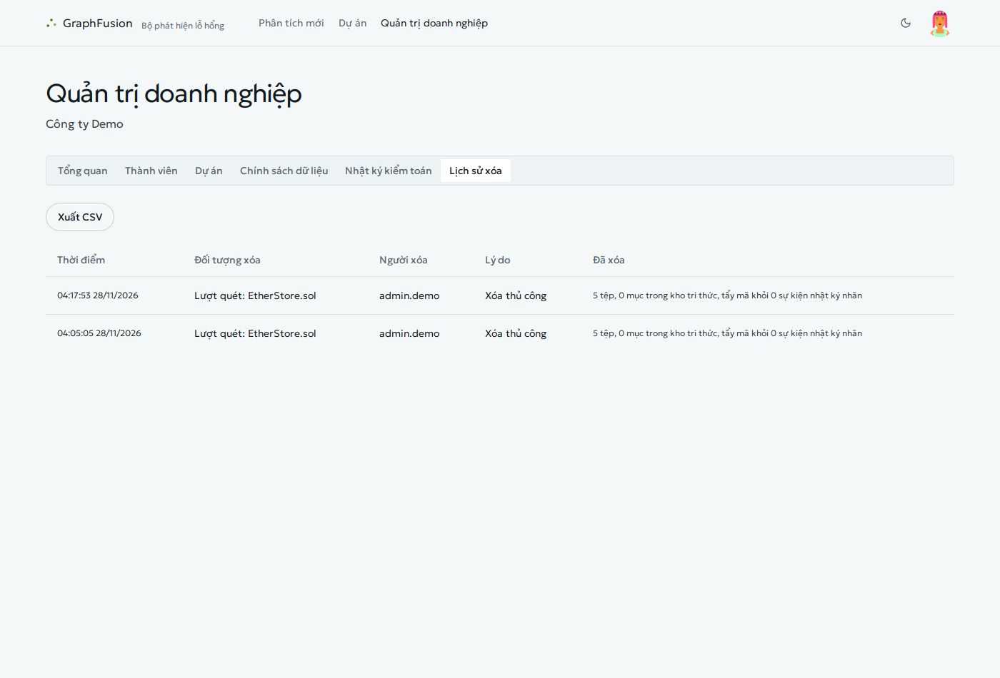
