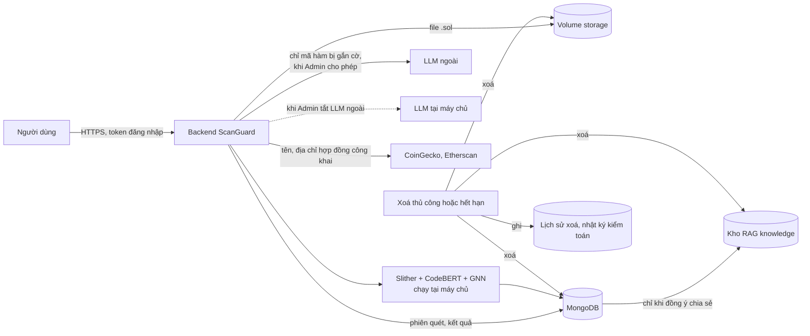

# Kế hoạch: Bảo vệ mã nguồn tải lên

Tài liệu tổng hợp kế hoạch đáp ứng yêu cầu cải tiến "Bảo vệ mã nguồn tải lên" của ban tổ chức, kèm các yêu cầu bổ sung của nhóm (phân vai trò theo doanh nghiệp, xác nhận điều khoản khi đăng nhập lần đầu, dashboard quản trị). **Trạng thái: đã triển khai theo bản rút gọn ở mục 11 (mọi thành viên thấy mọi dự án của doanh nghiệp; Admin tạo tài khoản trực tiếp). Minh chứng: `docs/BAO_CAO_BAO_VE_MA_NGUON.md`. Thay đổi sau kế hoạch: khi đăng ký chọn tài khoản Cá nhân (khách) hoặc Doanh nghiệp; Non-tech có quyền như Developer nhưng giao diện và lời giải thích không dùng thuật ngữ; văn bản điều khoản có bản tiếng Việt và tiếng Anh. Bảng quyền cập nhật nằm trong báo cáo minh chứng.**

> **Vấn đề:** Hợp đồng và mã nguồn chưa công bố có thể chứa thông tin cần bảo vệ.
> **Yêu cầu:** Giới hạn quyền, thời gian lưu và khả năng xóa mã; mô tả xử lý tại máy chủ/dịch vụ ngoài.
> **Minh chứng:** Sơ đồ luồng dữ liệu, cấu hình quyền truy cập và demo xóa tệp.

## 1. Đối chiếu yêu cầu với kế hoạch

| Yêu cầu của BTC | Phần đáp ứng trong kế hoạch | Minh chứng nộp |
|---|---|---|
| Giới hạn quyền | Mục 4 (vai trò và bảng quyền), mục 6 (dashboard: thành viên, nhật ký kiểm toán) | Bảng quyền, ảnh dashboard, bản ghi nhật ký truy cập |
| Thời gian lưu | Mục 7.2 (tự xoá theo thời hạn), mục 6 (chính sách dữ liệu) | Cấu hình thời hạn lưu, ngày tự xoá hiển thị trên phiên |
| Khả năng xoá mã | Mục 7.1 (xoá phiên, dự án, tài khoản) | Demo xoá tệp, lịch sử xoá |
| Mô tả xử lý tại máy chủ/dịch vụ ngoài | Mục 8 (luồng dữ liệu), mục 5 (xác nhận gửi dữ liệu) | Sơ đồ luồng dữ liệu, bảng dữ liệu gửi ra ngoài |

## 2. Hiện trạng

### 2.1. Đã có

- Phiên quét và dự án được lọc theo `user_id`: người dùng thường chỉ thấy dữ liệu của mình.
- Token đăng nhập hết hạn sau 30 phút; `/metrics` khoá được bằng `METRICS_TOKEN`.
- Slither, CodeBERT và GNN chạy trong container tại máy chủ; log chỉ ghi độ dài mã, không ghi nội dung.
- MongoDB không mở cổng ra ngoài trong cấu hình production.
- Ô `training_consent` ở mỗi lần tải file; kho RAG (`knowledge`) chỉ nhận mã khi người dùng đồng ý.
- Nhánh LLM chạy tại máy chủ (`LOCAL_LLM_MODEL`) đã có trong mã.

### 2.2. Còn thiếu

| Vấn đề | Chi tiết |
|---|---|
| Không xoá được phiên quét | Không có API hay nút xoá phiên |
| Xoá dự án không xoá mã | `delete_project` chỉ xoá bản ghi dự án; file và phiên quét vẫn còn, trong khi giao diện ghi "xóa vĩnh viễn" |
| Không có thời hạn lưu | File trong volume `storage` và bản ghi trong MongoDB được giữ vô thời hạn |
| Chuyên gia đọc được mọi mã | `_session_query` cho tài khoản expert xem mọi phiên của mọi người dùng |
| Nhật ký nhãn lưu mã không xoá được | `label_log` lưu `function_code` kể cả khi người dùng không đồng ý; hash tính trên chính đoạn mã nên xoá mã sẽ làm hỏng chuỗi |
| Không ghi lại ai đọc mã | Chưa có nhật ký truy cập |
| Mã gửi ra dịch vụ ngoài mà người dùng không được báo | Production gọi LLM qua `token.astralx.com.vn`, `LOCAL_LLM_MODEL` để trống |
| Chưa có điều khoản, chính sách | Không có bước xác nhận khi đăng ký hoặc đăng nhập lần đầu |

### 2.3. Các chỗ đang lưu mã người dùng

| Chỗ lưu | Nội dung | Điều kiện lưu |
|---|---|---|
| Volume `storage` | File `.sol` gốc, đồ thị FCG | Mọi lần tải lên |
| MongoDB `analysis_sessions` | Kết quả quét, mã từng hàm, bản sửa | Mọi lần tải lên |
| MongoDB `label_log` | Mã hàm và kết luận của chuyên gia | Mọi kết luận rà soát |
| MongoDB `knowledge` (RAG) | Mã hàm, bản sửa đã duyệt | Chỉ khi đồng ý cho dùng làm dữ liệu huấn luyện |
| Dịch vụ LLM ngoài | Mã hàm bị gắn cờ | Bước giải thích, trợ lý sửa lỗi, repair agent |

## 3. Mô hình tổ chức

- **Doanh nghiệp (workspace)** sở hữu dự án và mã nguồn. Mỗi tài khoản thuộc đúng một doanh nghiệp. Người đăng ký cá nhân có một workspace riêng chỉ có mình họ.
- **Bốn vai trò trong doanh nghiệp:** Admin, Developer, Non-tech, Expert.
- **Admin** là quản trị kinh doanh của doanh nghiệp khách hàng, không phải người vận hành ScanGuard.
- **Expert** là chuyên gia nội bộ của doanh nghiệp. Doanh nghiệp muốn thuê chuyên gia của ScanGuard thì Admin cấp quyền rà soát cho từng dự án.
- **Đội vận hành ScanGuard** quản lý máy chủ, mô hình và metrics. Đây không phải vai trò của khách hàng, và đội này không đọc mã của doanh nghiệp.

## 4. Vai trò và bảng quyền

✓ được phép · ✗ không được phép · ◐ có giới hạn (xem ghi chú)

| Quyền | Admin | Developer | Non-tech | Expert |
|---|---|---|---|---|
| **Thành viên và chính sách** | | | | |
| Mời, xoá thành viên, gán vai trò | ✓ | ✗ | ✗ | ✗ |
| Đặt thời hạn lưu mã | ✓ | ✗ | ✗ | ✗ |
| Cho phép gửi mã ra LLM ngoài hoặc chuyên gia ScanGuard | ✓ | ✗ | ✗ | ✗ |
| Đồng ý cho dùng mã làm dữ liệu huấn luyện | ✓ | ✗ | ✗ | ✗ |
| Xem mức sử dụng và nhật ký kiểm toán | ✓ | ✗ | ✗ | ✗ |
| **Dự án** | | | | |
| Tạo dự án, tải mã lên, tra cứu token | ✓ | ✓ | ✗ ¹ | ✓ |
| Xem báo cáo kết luận | ✓ | ◐ ² | ◐ ² | ◐ ² |
| Xem mã nguồn, IDE, chi tiết kỹ thuật | ✓ | ◐ ² | ✗ | ◐ ² |
| Tải SARIF, tích hợp CI | ✓ | ◐ ² | ✗ | ◐ ² |
| Trợ lý sửa lỗi, repair agent, biên dịch bản sửa | ✗ | ◐ ² | ✗ | ◐ ² |
| Gửi cảnh báo cho chuyên gia rà soát | ✓ | ◐ ² | ◐ ² | ✗ |
| Xoá phiên quét | ✓ | ◐ ³ | ✗ | ✗ |
| Xoá dự án, xoá toàn bộ dữ liệu doanh nghiệp | ✓ | ✗ | ✗ | ✗ |
| **Rà soát** | | | | |
| Xác nhận hoặc bác bỏ cảnh báo | ✗ | ✗ | ✗ | ◐ ² |
| Duyệt bản sửa | ✗ | ✗ | ✗ | ◐ ² |

¹ Non-tech là người đọc báo cáo (quản lý, nhà đầu tư, pháp chế), không tải mã lên.
² Chỉ trong các dự án mà Admin đã thêm người đó vào.
³ Chỉ các phiên do chính người đó tạo.

**Nguyên tắc:**

1. **Quyền theo dự án.** Thành viên chỉ thấy dự án mình được thêm vào; Admin thấy mọi dự án của doanh nghiệp.
2. **Admin quản trị nhưng không tự duyệt.** Admin không xác nhận cảnh báo và không duyệt bản sửa, để kết luận về an toàn do chuyên gia đưa ra.
3. **Mã chỉ rời khỏi doanh nghiệp khi Admin cho phép**, áp dụng cho LLM ngoài, chuyên gia ScanGuard và dữ liệu huấn luyện.
4. **Kiểm tra quyền ở máy chủ.** Mọi endpoint đi qua một hàm kiểm tra theo doanh nghiệp, dự án và vai trò, thay cho `_session_query` hiện tại. Giao diện ẩn nút chỉ để tiện dùng, không phải lớp bảo vệ.

## 5. Xác nhận khi đăng nhập lần đầu

Màn hình hiện sau khi đăng ký hoặc ở lần đăng nhập đầu tiên; người dùng phải xử lý xong mới dùng được sản phẩm.

| Mục | Bắt buộc | Mặc định | Nếu không đồng ý |
|---|---|---|---|
| Điều khoản sử dụng và giấy phép phần mềm | Có | Chưa chọn | Không dùng được sản phẩm |
| Chính sách xử lý dữ liệu cá nhân | Có | Chưa chọn | Không dùng được sản phẩm |
| Cam kết có quyền tải mã lên | Có | Chưa chọn | Không dùng được sản phẩm |
| Cho dùng mã và kết luận rà soát làm dữ liệu huấn luyện | Không | Tắt | Vẫn dùng đầy đủ sản phẩm |

- Không có nút "Đồng ý tất cả", không chọn sẵn ô nào.
- **Chính sách dữ liệu cá nhân** nêu rõ: thu email, tên đăng nhập, họ tên; chuyên gia thấy tên người gửi rà soát nhưng không thấy email; thông tin cá nhân không gửi ra dịch vụ ngoài; mã hàm bị gắn cờ được gửi tới LLM ngoài nếu Admin bật.
- **Thành viên doanh nghiệp** chỉ xác nhận ba mục bắt buộc; mục dữ liệu huấn luyện do Admin quyết định và thành viên được thông báo trạng thái.
- Ô `training_consent` ở mỗi lần tải file vẫn giữ, điền sẵn theo lựa chọn chung; tắt được cho từng file, không bật được khi Admin đã tắt.

**Phần máy chủ:**

1. Bốn văn bản dạng markdown có phiên bản trong `src/legal/` (đi kèm image backend), phục vụ qua API.
2. Collection `consents` chỉ thêm, không sửa: người dùng, văn bản, phiên bản, đồng ý hay không, thời điểm.
3. Chưa đồng ý phiên bản hiện tại của các mục bắt buộc thì mọi API, trừ đăng nhập, xem văn bản và gửi xác nhận, trả lỗi.
4. Văn bản đổi phiên bản thì người dùng được hỏi lại ở lần đăng nhập kế tiếp.

**Rút lại đồng ý** (trang hồ sơ, mục "Quyền riêng tư"):

- Tắt chia sẻ dữ liệu huấn luyện: áp dụng cho lần tải sau và xoá mã của người đó khỏi kho RAG. Mô hình đã huấn luyện từ dữ liệu cũ không gỡ được phần đã học; chính sách ghi rõ điều này.
- Xoá tài khoản: xoá thông tin cá nhân, phiên quét và file; nhật ký nhãn được giữ nhưng tên người dùng thay bằng mã ẩn danh.

## 6. Dashboard quản trị (`/admin`)

Chỉ Admin của doanh nghiệp truy cập được. Dashboard chỉ hiện thông tin mô tả, không hiện mã nguồn.

| Trang | Nội dung | Thao tác |
|---|---|---|
| Tổng quan | Số dự án, phiên quét trong tháng, cảnh báo theo lỗ hổng, cảnh báo chờ rà soát, số xác nhận/bác bỏ, bản sửa đã duyệt, dung lượng lưu, số phiên sắp tự xoá | Xem |
| Thành viên | Tên, email, vai trò, dự án, trạng thái xác nhận điều khoản, lần đăng nhập cuối | Thêm, đổi vai trò, gán dự án, khoá, xoá |
| Dự án | Thành viên, số phiên, số cảnh báo, dung lượng, quyền rà soát của chuyên gia ScanGuard | Xoá dự án kèm toàn bộ phiên và file |
| Chính sách dữ liệu | Thời hạn lưu, gửi mã ra LLM ngoài, dữ liệu huấn luyện, chuyên gia ScanGuard | Bật/tắt, đổi số ngày |
| Nhật ký kiểm toán | Ai xem mã phiên nào, ai xoá gì, ai đổi vai trò, ai đổi chính sách | Lọc theo người, thao tác, thời gian; xuất CSV |
| Lịch sử xoá | Xoá cái gì, do ai hoặc do hết hạn, lúc nào, đã xoá ở những chỗ nào | Xem, xuất CSV |

- Admin không hạ quyền được chính mình nếu là Admin cuối cùng.
- Khi tắt LLM ngoài, bước giải thích và trợ lý sửa lỗi dùng mô hình tại máy chủ hoặc bị tắt nếu máy chủ chưa cài.
- Chính sách được đọc tại đúng chỗ thực thi (hàm gọi LLM, bước tải file, tác vụ tự xoá), nên tắt trên dashboard là tắt thật.
- Không đưa vào dashboard: đọc mã nguồn (Admin mở dự án như thành viên, lượt xem được ghi nhật ký), quản lý mô hình và metrics máy chủ (thuộc đội vận hành ScanGuard), thanh toán.

**Phần máy chủ:** `require_admin`; nhóm API `/org/...`; collection `audit_log` chỉ thêm, ghi ở các chỗ xem mã nguồn, xoá, đổi vai trò, đổi chính sách.

## 7. Thời gian lưu và xoá mã

### 7.1. Xoá

- `DELETE /sessions/{id}`: xoá bản ghi phiên, thư mục trong `storage` (file gốc và đồ thị) và các mục `knowledge` của phiên.
- `delete_project` gọi cùng hàm xoá cho mọi phiên của dự án, để lời hứa "xóa vĩnh viễn" trên giao diện thành đúng.
- **`label_log`:** không xoá sự kiện mà tẩy mã của phiên bị xoá. Hash của sự kiện tính trên `sha256(function_code)` thay vì chính đoạn mã, nên tẩy mã không làm hỏng chuỗi. Sự kiện của người dùng không đồng ý chia sẻ dữ liệu thì không lưu mã ngay từ đầu. Cần chạy di chuyển dữ liệu một lần để tính lại chuỗi hash cho sự kiện cũ.
- Mỗi lần xoá ghi một dòng vào lịch sử xoá (không chứa mã).

### 7.2. Thời hạn lưu

- Admin đặt số ngày trên dashboard; mặc định 30 ngày.
- Tác vụ nền chạy mỗi giờ, xoá phiên quá hạn bằng hàm ở mục 7.1.
- Trang kết quả hiển thị ngày tự xoá.
- Mã đã vào kho RAG theo đồng ý của người dùng được giữ theo chính sách riêng, ghi trong chính sách dữ liệu.

## 8. Luồng dữ liệu

| Dữ liệu | Đi tới | Điều kiện |
|---|---|---|
| File `.sol` đầy đủ | Chỉ máy chủ ScanGuard | Luôn luôn |
| Mã từng hàm bị gắn cờ | LLM ngoài | Admin bật; nếu tắt thì dùng LLM tại máy chủ |
| Tên và địa chỉ hợp đồng | CoinGecko, Etherscan | Chỉ khi tra cứu token; đây là dữ liệu công khai |
| Email, tên người dùng | Không đi ra ngoài | — |
| Mã hàm và kết luận rà soát | Kho RAG, dữ liệu huấn luyện | Chỉ khi đồng ý chia sẻ |

## 9. Minh chứng sẽ nộp

| Minh chứng BTC yêu cầu | Nội dung cụ thể |
|---|---|
| Sơ đồ luồng dữ liệu | Sơ đồ và bảng ở mục 8 |
| Cấu hình quyền truy cập | Bảng quyền mục 4; ảnh trang Thành viên và Chính sách dữ liệu; bản ghi nhật ký kiểm toán khi một thành viên không thuộc dự án bị từ chối xem mã |
| Demo xoá tệp | Tải file lên, xem mã, xoá phiên; gọi lại API trả 404; thư mục `storage` không còn file; mục kho RAG đã biến mất; dòng tương ứng trong lịch sử xoá; `verify_events` báo chuỗi hash nhật ký nhãn vẫn nguyên vẹn |
| Bổ sung | Ảnh màn hình xác nhận lần đầu; một bản ghi `consents` mẫu; demo từ chối mục bắt buộc thì không vào được hệ thống |

Kèm một test tự động cho phần xoá: sau khi xoá, phiên, file và mục `knowledge` không còn, và chuỗi hash nhật ký nhãn vẫn hợp lệ.

## 10. Thứ tự triển khai

| Bước | Nội dung | Phục vụ minh chứng |
|---|---|---|
| 1 | Hàm xoá dùng chung, `DELETE /sessions/{id}`, sửa `delete_project`, đổi hash `label_log` và di chuyển dữ liệu | Demo xoá tệp |
| 2 | Thời hạn lưu và tác vụ tự xoá | Thời gian lưu |
| 3 | Doanh nghiệp, bốn vai trò, hàm kiểm tra quyền thay `_session_query`, chuyển tài khoản cũ thành workspace riêng | Cấu hình quyền truy cập |
| 4 | Nhật ký kiểm toán và lịch sử xoá | Cấu hình quyền truy cập, demo xoá tệp |
| 5 | Dashboard: Thành viên, Chính sách dữ liệu, Nhật ký kiểm toán, Lịch sử xoá | Cấu hình quyền truy cập |
| 6 | Xác nhận khi đăng nhập lần đầu, bốn văn bản, `consents`, mục Quyền riêng tư | Mô tả xử lý dữ liệu |
| 7 | Chính sách LLM ngoài đọc tại chỗ thực thi, thông báo trên trang tải lên | Mô tả xử lý dịch vụ ngoài |
| 8 | Dashboard: Tổng quan, Dự án | Hỗ trợ demo |
| 9 | Sơ đồ luồng dữ liệu, ảnh màn hình, viết phần báo cáo | Toàn bộ |

## 11. Các quyết định cần chốt

| # | Câu hỏi | Đề xuất |
|---|---|---|
| 1 | Bản đầy đủ (quyền theo dự án) hay bản rút gọn (mọi thành viên thấy mọi dự án của doanh nghiệp, Admin tạo tài khoản trực tiếp thay vì mời qua email)? | Bản rút gọn trước nếu cần kịp nộp; quyền theo dự án làm sau |
| 2 | Expert là chuyên gia nội bộ của doanh nghiệp? | Có; chuyên gia ScanGuard chỉ vào được khi Admin cấp cho từng dự án |
| 3 | Thời hạn lưu mặc định | 30 ngày |
| 4 | Đổi cách tính hash `label_log` để tẩy được mã khi xoá | Đổi; chạy di chuyển dữ liệu một lần trên production |
| 5 | Tài khoản đã có trên production | Mỗi tài khoản thành một workspace riêng với vai trò Admin; tài khoản expert hiện có giữ vai trò Expert |

## 12. Lưu ý

- **Pháp lý:** Nghị định 13/2023/NĐ-CP và Luật Bảo vệ dữ liệu cá nhân yêu cầu nêu rõ mục đích, đồng ý riêng cho từng mục đích và cho phép rút lại; thiết kế ở mục 5 đi theo các yêu cầu đó. Chưa đối chiếu nguyên văn điều khoản.
- **Văn bản điều khoản và chính sách** cần người có chuyên môn pháp lý đọc lại trước khi đưa lên production.
- **Nhật ký kiểm toán** chỉ ghi từ lúc triển khai; lượt xem mã trước đó không truy lại được.
- **Thu hẹp quyền Expert** làm hàng chờ rà soát rỗng với các phiên cũ chưa được gửi rà soát.
- **Chưa kiểm tra:** bộ đệm embedding có lưu nguyên văn mã hay không (nếu có, hàm xoá ở mục 7.1 phải xoá cả ở đó); khối lượng dữ liệu `label_log` trên production.
