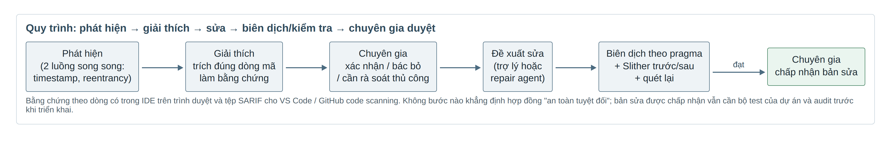
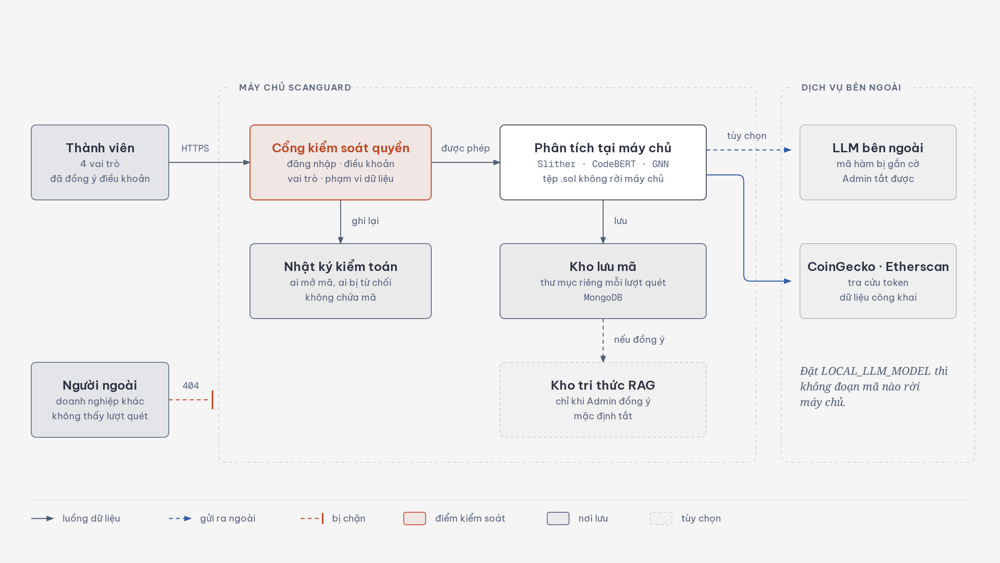
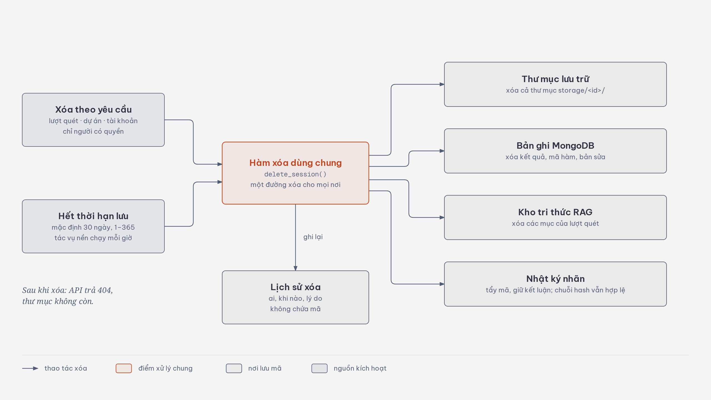
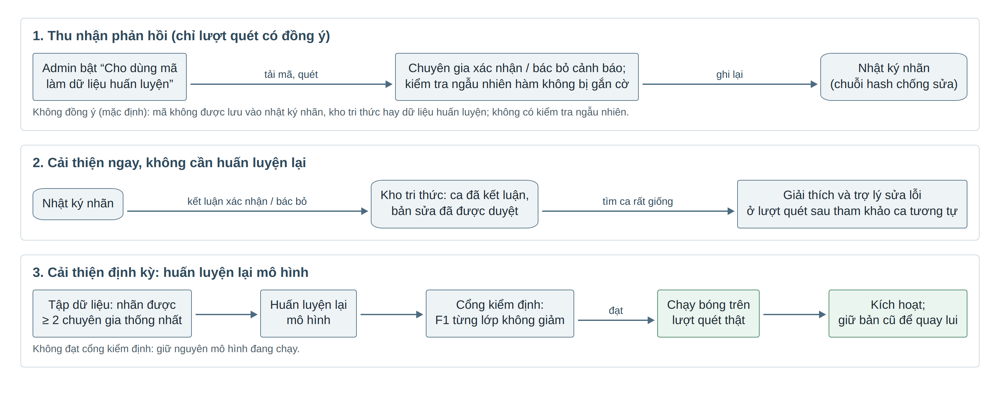
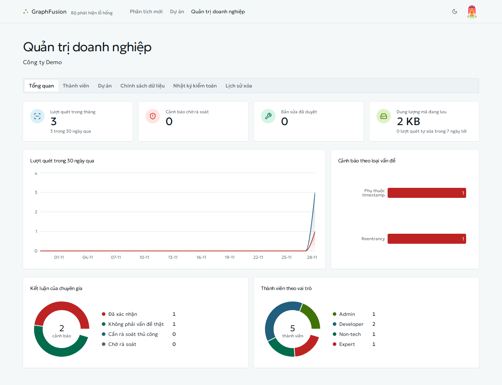
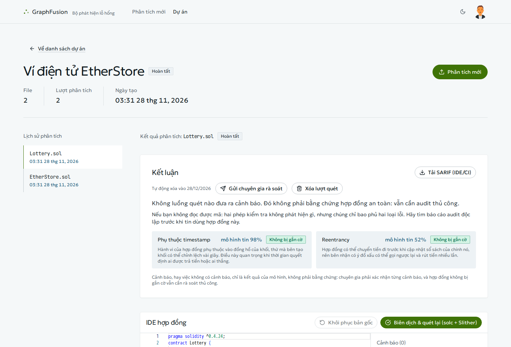

# Tóm tắt

ScanGuard phát hiện hai loại lỗ hổng phổ biến của hợp đồng thông minh Solidity, phụ thuộc thời gian khối (timestamp dependency) và tái nhập (reentrancy), bằng cách kết hợp biểu diễn ngữ nghĩa của từng hàm (CodeBERT fine-tune theo lỗ hổng) với đồ thị gọi hàm (GNN). Sản phẩm đang chạy tại https://scanguard.ptitai.org.

Qua hai chặng, sản phẩm đã đáp ứng bốn yêu cầu cải tiến của ban tổ chức:

| Yêu cầu | Kết quả chính |
|---|---|
| **Chặng 1.** Chứng minh đóng góp của kiến trúc kết hợp | Benchmark và ablation trên cùng tập, cùng phần cứng: GFD đạt macro-F1 0,85 (timestamp) và 0,73 (reentrancy), cao hơn Slither, bản bỏ ngữ nghĩa và bản dùng CodeBERT chưa fine-tune; phần lớn khác biệt có ý nghĩa thống kê |
| **Chặng 1.** Kiểm thử khả năng khái quát và ca khó | Nhận đúng 21/32 và 46/73 ca âm khó (bộ lọc cú pháp: 0); không bỏ sót lỗi ở hợp đồng trên 500 dòng; giữ kết luận ở 6/8 phép biến đổi đối kháng; xác định rõ giới hạn trên dự án hoàn toàn mới (DAppSCAN) |
| **Chặng 1.** Quy trình sửa lỗi có người xác nhận | Luồng phát hiện → giải thích có trích dòng → chuyên gia xác nhận → sửa → biên dịch và kiểm tra lại → chuyên gia duyệt; bằng chứng đưa vào IDE và SARIF cho CI; không khẳng định "an toàn tuyệt đối" |
| **Chặng 2.** Bảo vệ mã nguồn tải lên | Bốn vai trò và phân quyền kiểm tra tại máy chủ; thời hạn lưu và tự xóa; xóa mã ở mọi nơi lưu; chính sách gửi mã ra dịch vụ ngoài; nhật ký kiểm toán; đồng ý điều khoản; luồng tự cải thiện chỉ khi người dùng cho phép |

# Chặng 1

## 1. Chứng minh đóng góp của kiến trúc kết hợp

> **Vấn đề:** Các chỉ số F1 hiện gắn với bộ đánh giá đã mô tả, chưa đủ xác định từng thành phần tạo ra mức cải thiện bao nhiêu.
>
> **Yêu cầu:** So công cụ phân tích tĩnh và các bản bỏ đồ thị/bỏ ngữ nghĩa trên cùng tập, phần cứng; đo F1 theo lớp, thời gian và tài nguyên.
>
> **Minh chứng:** Bảng benchmark và ablation có cấu hình tái hiện, phân tích trường hợp cải thiện hoặc suy giảm.

**Cấu hình tái hiện.** Bộ dữ liệu của bài báo (đã loại trùng hàm giữa tập huấn luyện và kiểm thử); GPU NVIDIA L40S, CPU Xeon Gold 6542Y; PyTorch 2.4.0, DGL 2.4.0, Slither 0.8.0. Mọi biến thể học máy huấn luyện lại cùng quy trình (seed 42, chọn epoch trên tập validation, không dùng tập kiểm thử để chọn). Kiểm định McNemar so với GFD đầy đủ. Script tái hiện: `eval/ablation/run_all.sh`.

**Kết quả (macro-F1 và F1 theo lớp):**

| Hệ thống | Timestamp: F1 không lỗi / có lỗi | Timestamp: macro-F1 (p) | Reentrancy: F1 không lỗi / có lỗi | Reentrancy: macro-F1 (p) |
|---|---|---|---|---|
| **GFD đầy đủ** | 0,85 / 0,85 | **0,85** | 0,71 / 0,76 | **0,73** |
| Bỏ ngữ nghĩa (chỉ đặc trưng cấu trúc) | 0,74 / 0,78 | 0,76 (0,010) | 0,71 / 0,65 | 0,68 (0,35) |
| CodeBERT chưa fine-tune | 0,80 / 0,78 | 0,79 (0,027) | 0,54 / 0,70 | 0,62 (0,034) |
| Slither | 0,74 / 0,76 | 0,75 (0,007) | 0,69 / 0,55 ¹ | 0,62 (0,072) ¹ |

¹ Detector `reentrancy-eth`; nếu tính mọi detector `reentrancy-*`, macro-F1 chỉ 0,55 (p = 0,003).

**Đóng góp từng thành phần:**

- **Ngữ nghĩa** giúp phân biệt hàm dùng thời gian khối để ra quyết định với hàm chỉ ghi lại thời gian; bỏ đi làm macro-F1 giảm 9 điểm ở timestamp.
- **Bước fine-tune theo lỗ hổng** là nguồn giá trị chính: CodeBERT chưa fine-tune kém GFD 6 điểm (timestamp) và 11 điểm (reentrancy), ở reentrancy còn kém cả bản chỉ dùng cấu trúc.
- **So với phân tích tĩnh,** quy tắc cố định của Slither buộc đánh đổi: quy tắc rộng bắt gần hết lỗi nhưng báo nhầm nhiều, quy tắc hẹp thì ngược lại; GFD cân bằng hơn giữa hai lớp.
- **Thời gian và tài nguyên:** suy luận GNN 2,5–6,4 ms mỗi hợp đồng; toàn bộ xử lý một hợp đồng chậm hơn Slither 1,5–2,3 lần, phần lớn thời gian ở bước dựng đồ thị và mã hóa hàm; bộ nhớ GPU đỉnh khi huấn luyện 0,46–4,4 GB.
- **Suy giảm còn lại:** ở reentrancy, GFD còn báo nhầm hợp đồng đã viết đúng thứ tự "cập nhật số dư trước, chuyển tiền sau", vì mô hình nhận ra lệnh chuyển tiền hơn là thứ tự câu lệnh. Đây là cơ sở để yêu cầu chuyên gia xác nhận ở mục 3.

## 2. Kiểm thử khả năng khái quát và ca khó

> **Vấn đề:** Lỗ hổng trên hợp đồng lớn hoặc mã cố tình gây nhiễu có thể khác benchmark.
>
> **Yêu cầu:** Thử dự án chưa thấy, hợp đồng lớn, mã đối kháng và ca dương/âm khó; phân tích cảnh báo nhầm/bỏ sót.
>
> **Minh chứng:** Bộ ví dụ mã, vị trí dòng và kết quả so với đánh giá chuyên môn.

Tiêu chí là F1, không chỉ recall: một bộ lọc cú pháp báo lỗi mọi hợp đồng có `now` hoặc `call.value` đã đạt recall gần 100%, nên giá trị của mô hình nằm ở việc nhận ra hợp đồng có cú pháp nhạy cảm nhưng không có lỗi.

| Phép thử | Kết quả chính |
|---|---|
| **Ca âm khó** (có cú pháp nhạy cảm nhưng không lỗi) | GFD nhận đúng 21/32 (timestamp) và 46/73 (reentrancy); bộ lọc cú pháp: 0. F1 reentrancy: GFD 0,76, bộ lọc 0,66, Slither 0,55 |
| **Hợp đồng lớn** (trên 500 dòng) | Phát hiện 4/5 và 13/14 hợp đồng có lỗi; hợp đồng lớn nhất (2.053 dòng, 328 hàm) kết luận đúng; trung vị 1,7–2,0 giây mỗi hợp đồng |
| **Mã đối kháng** (5 phép biến đổi giữ nguyên ngữ nghĩa) | Giữ kết luận ở 6/8 phép thử; không phép nào che được lỗi timestamp; hai điểm yếu: đọc thời gian qua hàm thư viện, chèn mã chết vào hợp đồng reentrancy |
| **Dự án chưa thấy** (DAppSCAN, nhãn từ báo cáo audit có số dòng) | Phát hiện đúng hàm tại các vị trí auditor chỉ ra như `wHakka.unstake` (dòng 580); kết quả thấp do khác biệt dữ liệu: phần lớn là Solidity 0.6–0.8 nhiều file, trong khi dữ liệu huấn luyện chủ yếu là Solidity 0.4 một file |

**Cảnh báo nhầm và bỏ sót** được ghi đến từng hợp đồng, từng hàm và dòng mã trong `eval/generalization/` và `eval/dappscan/`. Kết luận: trong phạm vi dữ liệu huấn luyện, mô hình giữ được F1 với hợp đồng lớn, mã gây nhiễu và ca khó; để dùng cho dự án Solidity mới cần bổ sung dữ liệu huấn luyện loại này.

## 3. Quy trình sửa lỗi có người xác nhận

> **Vấn đề:** Cảnh báo hoặc không có cảnh báo đều không đủ chứng minh hợp đồng an toàn.
>
> **Yêu cầu:** Đưa bằng chứng và dòng mã vào IDE/CI nếu khả thi; yêu cầu chuyên gia xác nhận cảnh báo và chạy biên dịch/kiểm thử khi đề xuất sửa, không tự khẳng định 'an toàn tuyệt đối'.
>
> **Minh chứng:** Demo phát hiện → giải thích → sửa → biên dịch/test và trường hợp cần rà soát thủ công.

{width=100%}

- **Bằng chứng theo dòng mã:** lời giải thích phải trích đúng dòng của hàm; IDE trên trình duyệt tô đúng dòng bị gắn cờ; mỗi lượt quét xuất được tệp SARIF 2.1.0 cho VS Code và GitHub code scanning, kèm GitHub Action mẫu cho CI.
- **Chuyên gia xác nhận:** chỉ chuyên gia được xác nhận, bác bỏ cảnh báo và chấp nhận bản sửa; chỉ chấp nhận bản sửa của cảnh báo đã xác nhận và đã biên dịch được; quyết định gắn với đúng phiên bản bản sửa mà chuyên gia đã xem. Các quy tắc này được máy chủ thực thi.
- **Biên dịch và kiểm tra lại:** bản sửa được ghép vào hợp đồng gốc, biên dịch bằng đúng bản solc theo `pragma`, chạy Slither trước và sau, và quét lại bằng mô hình; bước này chạy trong tiến trình cô lập, giới hạn thời gian và bộ nhớ.
- **Không khẳng định an toàn:** giao diện, SARIF và lời giải thích đều ghi rõ cảnh báo cần chuyên gia xác nhận và hợp đồng không bị cảnh báo vẫn cần audit thủ công.
- **Demo** trên `EtherStore.sol`: phát hiện hàm `withdrawFunds`; chuyên gia xác nhận cảnh báo reentrancy và bác cảnh báo timestamp; bản sửa hỏng bị từ chối vì không biên dịch được; bản sửa đúng biên dịch được và được chuyên gia chấp nhận.
- **Rà soát thủ công** khi: hợp đồng không biên dịch được, hợp đồng bị gắn cờ nhưng không định vị được hàm, chuyên gia chọn "cần rà soát thủ công", không có cảnh báo nào, hoặc bản sửa đã được chấp nhận nhưng chưa qua bộ test của dự án.

# Chặng 2

## 4. Bảo vệ mã nguồn tải lên

> **Vấn đề:** Hợp đồng và mã nguồn chưa công bố có thể chứa thông tin cần bảo vệ.
>
> **Yêu cầu:** Giới hạn quyền, thời gian lưu và khả năng xóa mã; mô tả xử lý tại máy chủ/dịch vụ ngoài.
>
> **Minh chứng:** Sơ đồ luồng dữ liệu, cấu hình quyền truy cập và demo xóa tệp.

### 4.1. Xử lý tại máy chủ và dịch vụ ngoài

{width=90%}

Mô hình phát hiện lỗ hổng chạy hoàn toàn trên máy chủ ScanGuard. Chỉ đoạn mã của từng hàm bị gắn cờ được gửi tới dịch vụ AI để viết giải thích và gợi ý sửa, và chỉ khi chính sách của doanh nghiệp cho phép; thông tin cá nhân không đi ra ngoài. Trang tải lên luôn cho người dùng biết mã được lưu bao lâu và có được gửi ra ngoài hay không.

### 4.2. Giới hạn quyền

Khi đăng ký, người dùng chọn tài khoản **Cá nhân** hoặc **Doanh nghiệp**. Doanh nghiệp có bốn vai trò:

| Quyền | Admin | Developer | Non-tech | Expert |
|---|---|---|---|---|
| Tải mã lên, tạo dự án | ✓ | ✓ | ✓ | ✓ |
| Xem mã nguồn, tải báo cáo | ✓ | Của mình | Của mình | ✓ |
| Trợ lý sửa lỗi | ✗ | ✓ | ✓ | ✓ |
| Xóa lượt quét / dự án | Mọi | Của mình | Của mình | ✗ |
| Duyệt cảnh báo và bản sửa | ✗ | ✗ | ✗ | ✓ |
| Thành viên, chính sách, nhật ký | ✓ | ✗ | ✗ | ✗ |

Quyền được kiểm tra tại máy chủ; người ngoài doanh nghiệp không thấy sự tồn tại của mã; đổi vai trò có hiệu lực ngay. Mọi lần mở mã, bị từ chối truy cập, xóa, đổi vai trò và đổi chính sách được ghi vào nhật ký kiểm toán, xuất được ra CSV. Non-tech dùng như Developer nhưng giao diện và lời giải thích dùng lời lẽ phổ thông.

### 4.3. Thời gian lưu và xóa mã

{width=90%}

- **Thời hạn lưu** do Admin đặt (1–365 ngày, mặc định 30); hệ thống tự xóa lượt quét quá hạn mỗi giờ; ngày tự xóa hiện trên từng kết quả.
- **Xóa theo yêu cầu:** lượt quét, dự án, tài khoản.
- **Xóa ở mọi nơi lưu mã:** tệp, kết quả quét, kho tri thức; mã được tẩy khỏi nhật ký kết luận của chuyên gia mà nhật ký vẫn chống sửa được. Lịch sử xóa ghi ai xóa, xóa gì, lý do, không chứa mã.
- **Demo xóa tệp:** sau khi Admin xóa lượt quét, mở lại mã trả "không tìm thấy", thư mục lưu trữ không còn, lịch sử xóa ghi 5 tệp đã xóa.

### 4.4. Đồng ý điều khoản và luồng tự cải thiện

Người dùng mới phải đồng ý điều khoản sử dụng, chính sách dữ liệu và cam kết quyền tải mã lên (bản tiếng Việt và tiếng Anh). Việc cho dùng mã làm dữ liệu huấn luyện là tùy chọn, mặc định tắt. Chỉ khi được phép, hệ thống mới dùng kết luận của chuyên gia để tự cải thiện:

{width=100%}

- **Cải thiện ngay:** kết luận và bản sửa đã duyệt vào kho tri thức, giúp giải thích và trợ lý sửa lỗi ở các lượt quét sau.
- **Cải thiện định kỳ:** chỉ dùng nhãn được ít nhất hai chuyên gia thống nhất; mô hình huấn luyện lại phải qua cổng kiểm định (F1 từng lớp không giảm) và chạy bóng trước khi được kích hoạt; mô hình cũ được giữ để quay lui.
- **Rút lại đồng ý:** mã bị gỡ khỏi kho tri thức ngay và không dùng cho lần huấn luyện sau.

### 4.5. Dashboard quản trị

{width=100%}

Admin có dashboard riêng với biểu đồ lượt quét theo ngày, cảnh báo theo loại, kết luận của chuyên gia, thành viên theo vai trò, cùng các trang thành viên, dự án, chính sách dữ liệu, nhật ký kiểm toán và lịch sử xóa. Dashboard không hiện mã nguồn.

# Các cải tiến khác của sản phẩm

- **Quét song song hai lỗ hổng** (timestamp và reentrancy), mỗi lỗ hổng có bộ mô hình riêng, kết quả gộp thành một kết luận cho hợp đồng.
- **Tra cứu token trên Ethereum:** lấy mã nguồn đã xác minh, gộp các tệp theo thứ tự phụ thuộc và dùng đúng phiên bản trình biên dịch đã triển khai; nâng Slither lên 0.9.6 để đọc được cú pháp Solidity mới.
- **Giao diện:** chế độ sáng và tối; tiếng Việt và tiếng Anh; lời lẽ phổ thông cho người dùng không chuyên kỹ thuật.
- **Kiểm thử tự động** của backend (79 bài) đều đạt trên bản đang triển khai; cơ sở dữ liệu được sao lưu trước mỗi lần cập nhật production.

{width=100%}

# Hướng phát triển tiếp

- **Mở rộng dữ liệu huấn luyện** với hợp đồng Solidity 0.6–0.8, dự án nhiều tệp và ca âm khó, để thu hẹp khoảng cách đã thấy trên DAppSCAN.
- **Vận hành vòng tự cải thiện** trên phản hồi thật của chuyên gia khi đủ dữ liệu, và tự động hóa lịch huấn luyện lại.
- **Giảm dần khối lượng rà soát lặp lại** của chuyên gia bằng cách sắp xếp và hiệu chỉnh độ tin cậy của cảnh báo; việc duyệt bản sửa và kết luận về an toàn vẫn do con người thực hiện.
